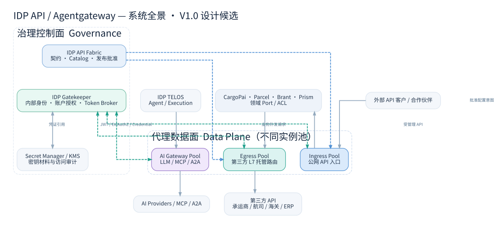

# G01 — IDP Gateway 产品需求、业务范围与验收目标

> **编号** G01 · Requirements · **版本** V1.0 · **基线日期** 2026-11-10  
> **状态** 设计候选（DESIGN_DRAFT）；尚无具名审批、真实网关集成或生产验证。  
> **上位规范** IDP-SCG-STD-001 V1.0；**先行约束** BIP 不再作为独立平台；所有技术承诺均依赖版本锁定与 PoC 实测。

## 0. 执行结论

本项目**不是自研通用代理引擎**，而是以 agentgateway 开源数据面为首选候选，为多个 IDP 产品建设可审计的 **Ingress / Egress / AI Gateway** 部署与配置能力。Gatekeeper 是内部身份、第三方账户授权和外部凭证治理权威；API Fabric 拥有 API 契约与治理发布权；Gateway 为访问策略执行点（PEP）；领域上下文保留对象级授权、业务状态、Port/ACL。

### 0.1 价值目标

| 编号 | 目标 | 可验证成果 | 排除的误解 |
|---|---|---|---|
| BG-01 | 外部客户安全访问 IDP 提供的 API | 公网 Ingress 认证、路由、限流和审计 | Gateway 不作运单对象授权最终决策 |
| BG-02 | 内部应用通过统一 Egress 地址消费第三方 HTTP/gRPC | 业务 Port/ACL → Gateway → 已登记 Provider，最小权限账户选择 | 不把所有协议或任意 URL 暴露成通用开放代理 |
| BG-03 | 统一第三方 API 的凭证使用治理 | Gatekeeper 控制账户授权、Token Broker；应用不持有被托管的第三方 Secret | 内部 JWT 不直接等于第三方 OAuth Token |
| BG-04 | AI 相关流量复用网关技术 | TELOS 专用 AI 实例池验证 LLM/MCP/A2A 的契约 | 不与公网货运 API 共享同一个必经实例 |
| BG-05 | 可追踪、可回滚、可替换 | 配置内容摘要、批准、应用、观察和撤回证据 | 发布成功≠生效成功；文档完成≠测试通过 |

## 1. 使用者、边界与流程

**使用者**：内部业务产品服务账户、外部 API 客户、开发者、平台运维、安全管理员、API Fabric 审批人与 Gatekeeper 凭证管理员。实际人工 UI 不在本期必交范围；同版增补的 Gateway Console 原型与 75 条 UX 用例已使 STD-CP4 适用（Manifest `user_interface=true`），其扩展在 P1 PoC 结论落地前冻结，见 `docs/governance/README.md`。

**网络信任域**：公网入口、内部业务入口、内部第三方出口、AI 入口、控制面与密钥域独立定义。一个统一产品名称或配置标准不意味着单一公共故障域。内部服务间通信不默认强制经中心网关；如组织决定全部强制走 Internal Gateway，须另补服务拓扑、延迟预算、容灾和可用性 ADR。

**MVP 请求生命周期**：应用携带 Gatekeeper 信任域签发的服务身份，调用受管理的 Egress 逻辑路径；网关验证 JWT 和请求级授权；可选凭证适配从获授权账户生成外发凭证；仅向已登记 upstream 透传请求；领域 ACL 将提供商响应翻译成内部结果。非幂等操作不会被代理层盲目自动重试。

**非目标**：BIP/ESB、EDI/SFTP 编排、跨系统业务映射、Workflow Engine、商业化 API 订阅计费、通用 Service Mesh、独立 IAM/IdP、业务领域对象授权、替代 Fabric、重写 agentgateway Rust 核心。

## 2. 功能性需求（FR）

需求状态均为 **PROPOSED**；用例和 PoC 检查映射见 G06 和 `tests/acceptance/acceptance_matrix.csv`。

| ID | Must/Should | 需求 | 验收观察点 |
|---|---|---|---|
| GW-FR-001 | MUST | Ingress 公开 API 仅路由已批准上游 | 访问未登记 Host/Route 一律拒绝 |
| GW-FR-002 | MUST | Egress 使用唯一逻辑域名和版本化 Provider Routes | 业务调用不需知道物理 upstream |
| GW-FR-003 | MUST | 客户端 JWT 验签并严格匹配 iss/aud/exp/nbf/算法 | 伪签名、错误受众和过期令牌拒绝 |
| GW-FR-004 | MUST | 外部授权结合服务、租户、环境、提供商账户、操作 | 跨租户/跨账户负向用例拒绝 |
| GW-FR-005 | MUST | 未注册目标、方法、路径和重定向默认拒绝 | 任意 URL 和内网探测无法通过 |
| GW-FR-006 | MUST | 第三方外发认证按已授权账号选择 | 无权指定账号无法借用 Token |
| GW-FR-007 | MUST | 凭证引用与密钥材料分离 | 配置、业务日志不含明文 Token |
| GW-FR-008 | MUST | 请求头清洗并禁止内部 Token 透传给外部域 | Provider 端不收到 IDP JWT |
| GW-FR-009 | MUST | 支持 HTTP 方法、Path、Query、Body、响应码透传 | 协议对照测试无非预期改写 |
| GW-FR-010 | MUST | gRPC Metadata/Status/Streaming 适用性验证 | 双向流特性不支持则记录边界 |
| GW-FR-011 | MUST | 请求大小、连接、整体超时预算和并发上限 | 异常请求不耗尽资源 |
| GW-FR-012 | MUST | 禁止默认重试非幂等写请求 | 结果未知由领域恢复 |
| GW-FR-013 | MUST | 发布配置须先校验、审批与版本化 | 未批准配置不可应用到生产池 |
| GW-FR-014 | MUST | Gateway 配置应用状态可回读与对账 | desired/applied/observed 独立记录 |
| GW-FR-015 | MUST | 故障时回滚到可用的上一个已批准配置 | 可测回滚时间与结果 |
| GW-FR-016 | MUST | 公网、出站、AI 独立实例池和安全策略 | 故障注入不跨池影响 |
| GW-FR-017 | MUST | Trace、指标、脱敏审计 | 可关联 IDP 与上游调用而不泄密 |
| GW-FR-018 | MUST | Secret、证书轮换与吊销流程 | 轮换/撤销后行为符合策略 |
| GW-FR-019 | MUST | 配额与分布式限流 | 多副本下可量化一致性 |
| GW-FR-020 | SHOULD | AI 流量专用路由与策略 | 与普通业务 API 域隔离 |
| GW-FR-021 | MUST | 网关与 Gatekeeper 间的可信通道及身份绑定 | 伪造授权服务响应不可成功 |
| GW-FR-022 | MUST | 请求身份上下文不得由客户端自填 Header 冒充 | 删除和重建信任上下文 |
| GW-FR-023 | MUST | 基于供应商身份注册的固定 host/SNI/TLS | 防 SSRF、DNS 重绑定与证书错误 |
| GW-FR-024 | MUST | Gateway 运行时与 Fabric 管理不可用相互隔离 | 受控缓存和故障策略可验证 |
| GW-FR-025 | SHOULD | 提供人工可阅读的故障码与调用关联 ID | 客户与运维可分辨 401/403/429/502/504 |
| GW-FR-026 | MUST | 操作执行前先检查提供商账户及 Credential Grant 有效性 | 撤销和失效能在规定窗口内生效 |
| GW-FR-027 | MUST | 接口与配置变更有明确权威和审批链 | 不出现 Fabric 和 Gateway 双主写配置 |
| GW-FR-028 | SHOULD | 提供多环境 Dev/Test/Prod 的隔离配置 | 沙箱 Token 不能使用到生产 |
| GW-FR-029 | MUST | 仅转发已认可的外部账户指定操作 | 路由级授权与账户级授权同时满足 |
| GW-FR-030 | SHOULD | 支持显式选择 Egress HTTP L7 与 CONNECT Tunnel | 需要凭证注入时不得选择不可见 L7 的透传 |
| GW-FR-031 | MUST | Ingress/Egress/AI RouteIntent 按流量类别分别校验 | 每类合法示例通过；跨类专有字段与缺少必填字段拒绝 |
| GW-FR-032 | MUST | 服务身份、租户、用户委托身份必须绑定可信来源 | 伪造 X-Tenant/X-User/Account、委托链不匹配全部拒绝 |
| GW-FR-033 | MUST | OAuth2/API Key/HMAC/mTLS 凭证按认证类型选择并最小暴露 | 缺少信任边界、过期、撤销、签名错误时拒绝且不泄密 |
| GW-FR-034 | MUST | Egress 固定批准目标并阻断 SSRF 与重定向绕过 | DNS 变化、IPv4/IPv6、私网、Host/SNI 和重定向负向测试 |
| GW-FR-035 | MUST | 共享 ProviderAccount 具备账户级并发与用量保护 | 跨实例一致性、账户和租户隔离与超额拒绝可验证 |
| GW-FR-036 | MUST | 为上游服务定义连接上限、并发上限、整体超时预算 | 负载、连接耗尽、慢请求和背压测试有确定结果 |
| GW-FR-037 | MUST | 上游健康、熔断、隔离与恢复规则明确 | 故障注入不影响其他提供商/账户，半开恢复可测 |
| GW-FR-038 | MUST | HTTP/gRPC Unary 与 Streaming 具备协议兼容性矩阵 | Trailer、Metadata、SSE、分块、大报文逐项验收或标明不支持 |
| GW-FR-039 | MUST | 配置意图编译必须通过固定版本 agentgateway 原生 schema/运行检查 | 未执行原生校验不得发布；本离线预检不替代原生验证 |
| GW-FR-040 | MUST | 受控发布支持审批、CAS、预检、灰度、观察和回滚 | 部分失败、超时未知状态、漂移均不得标 ACTIVE |
| GW-FR-041 | MUST | 按实例回读真实 observed digest 和健康状态 | Desired/Applied/Observed 对账、漂移告警和撤销处理可追溯 |
| GW-FR-042 | MUST | 消息诊断支持四阶段状态及受控按需捕获 | NOT_SENT/NOT_CAPTURED/TRUNCATED/UNKNOWN 区分、服务端权限和脱敏 |
| GW-FR-043 | MUST | 请求失败的产生层级可区分且写操作 UNKNOWN 不自动重试 | Gateway/Provider 401/403/429/502/504 根因、业务对账有证据 |
| GW-FR-044 | MUST | Gateway Console 使用服务器端授权和单一发布权威 | UI 越权、跨租户读报文、审批绕过和直写原生配置拒绝 |
| GW-FR-045 | MUST | 网关版本、配置 schema、镜像 digest、SBOM/升级兼容严格管理 | 升级回滚和配置格式迁移演练通过后方可发布 |
| GW-FR-046 | MUST | 生产策略明确限制原生管理 UI 的写路径及公网访问 | 不允许 UI/Fabric/Gateway 三方并行直写配置 |
| GW-FR-047 | MUST | 第三方账户授权撤销与缓存失效遵守高风险时限 | 撤销跨实例生效与 Gatekeeper 断连 fail-closed 可测 |
| GW-FR-048 | MUST | 配置与策略冲突在发布前检测且拒绝不确定性覆盖 | 完全重叠、优先级歧义和公共管理路由冲突检查 |
| GW-FR-049 | SHOULD | 按环境/实例池提供 SLO 与业务影响可观察视图 | 健康、错误预算和变更影响范围可链接到 Trace |
| GW-FR-050 | SHOULD | 只读诊断提供受控契约对比与安全沙箱请求预览 | 不允许默认重放生产非幂等写请求 |

## 3. 非功能与质量要求（NFR）

| ID | 属性 | 目标及测量要求 | 基线状态 |
|---|---|---|---|
| GW-NFR-01 | 隔离 | 10 类以上跨租户/账户负向用例全数拒绝；不得存在确认的越权路径 | 阈值候选，NOT_RUN |
| GW-NFR-02 | 附加延迟 | 与同网络直连基线测量 p50/p95/p99 增量，负载与硬件固定 | 数值阈值待容量评审 |
| GW-NFR-03 | 可用性 | Ingress/Egress/AI 三池分别定义 SLO、错误预算和恢复指标 | 待运营确认 |
| GW-NFR-04 | 策略一致性 | 生产池配置版本/摘要可回读，对账无未解释漂移 | NOT_RUN |
| GW-NFR-05 | 安全 | 所有未经批准的出口域/IP/端口组合拒绝；密钥无明文日志 | NOT_RUN |
| GW-NFR-06 | 故障恢复 | 授权服务/上游/DNS/Token 服务故障具有指定拒绝与恢复路径 | NOT_RUN |
| GW-NFR-07 | 观察性 | 每类失败有错误分类、可回溯 trace 和受控日志 | NOT_RUN |
| GW-NFR-08 | 容量 | 实测并发、连接数、吞吐、流式负载和内存基线 | 待工作负载清单 |
| GW-NFR-09 | 可替换性 | 领域 Port 不泄漏 agentgateway 专属配置/类型 | 静态结构检查候选 |
| GW-NFR-10 | 可维护性 | 配置不可变制品与可验证供应链 SBOM、签名、回滚 | NOT_RUN |
| GW-NFR-11 | 最小权限 | 不同环境/产品的 Gateway 工作负载身份分离 | NOT_RUN |
| GW-NFR-12 | 隐私合规 | 按实际数据流/法域判定驻留、脱敏、审计保留要求 | 待适用性审查 |
| GW-NFR-13 | 第三方配额隔离 | 按供应商账户、租户、操作测并发/限流误差及超额处理 | 正式阈值待提供商契约确认 |
| GW-NFR-14 | 报文诊断隐私 | 默认无正文捕获；脱敏前不得写入常规日志；捕获窗口有审批和上限 | 真实采集/脱敏负向测试 NOT_RUN |
| GW-NFR-15 | 配置生效可验证性 | 每副本 observed digest、最小健康观察期、灰度回滚和漂移处置 | 灰度/故障注入 NOT_RUN |
| GW-NFR-16 | 上游韧性 | 连接池、熔断、并发、慢请求、DNS/TLS 故障隔离有容量证据 | 基准容量待定 |
| GW-NFR-17 | 管理面安全 | 所有 Console/BFF 写与敏感查询服务端 ABAC、审计、双人复核 | 渗透与权限实测 NOT_RUN |
| GW-NFR-18 | 凭证撤销传播 | 高风险凭证使用失效时间可量化；故障默认拒绝 | 时间窗由安全负责人批准 |
| GW-NFR-19 | 协议兼容与升级 | HTTP/2、gRPC、流式、证书轮换以及网关版本升级兼容矩阵完整 | 选定版本后跑真实矩阵 |

## 4. 交付路线与风险门槛

**P0 — 设计与核验**：G01–G06、Manifest 草案、ADR Proposed、Mock Schema、安全负向测试、agentgateway 能力兼容矩阵。不能由文档直接通过生产门禁。

**P1 — 最小 PoC**：本地固定假 upstream 的 L7 代理；Gatekeeper JWT、外部授权、静态或模拟受控凭证；路径/Header/Body 透传；失败隔离。

**P2 — 第三方真实沙箱**：选一个承运商沙箱、至少两个租户/账号和两个调用身份；覆盖凭证刷新/轮换、未知结果、无权限访问、撤销传播。

**P3 — 生产候选**：多实例真实压测、灾难与 DNS/凭证故障注入、安全测试、发布与回滚、运营交接和具名批准。P0/P1/P2 不自动获得生产放行。

### 风险登记（初始）

| 风险 | 严重性 | 缓解策略 | 责任角色 |
|---|---|---|---|
| R-01 不同租户使用错误外部 Token | Critical | Gatekeeper 服务/租户/账户/操作复合授权、禁用任意 account header | 安全负责人 |
| R-02 CONNECT 透传无法注入凭证 | High | 需外发 Auth 时采用 L7 显式路由，单独验证 | 网关负责人 |
| R-03 Agentgateway 版本行为漂移 | High | 固定镜像 digest、官方 schema/CLI 及实测证据 | 平台负责人 |
| R-04 网关集中故障 | High | 分池多副本、熔断与独立升级、受控静态配置 | 运维负责人 |
| R-05 外部写操作重复提交 | Critical | Gateway 不重试非幂等操作，领域幂等/查询/对账 | 业务领域 Owner |
| R-06 SSRF / 代理滥用 | Critical | 严格注册目标/路由、限制重定向/DNS/IP、网络层出口隔离 | 安全负责人 |

## 5. 需求追溯

`GW-FR-*`、`GW-NFR-*` 追溯到 `tests/acceptance/acceptance_matrix.csv` 中的验收案例；正式实施前应将高风险 MUST 逐项补充负责人、环境、证据位置和实际结果。G02 负责系统边界，G03 路由发布，G04 安全，G05 工程执行，G06 测试门禁。**本版仅提供候选规范与部分可运行离线检查，不等于真实生产测试通过。**

## 6. Gateway Operations UI/UX 范围补充（G01 · V1.0 同版更新）

本项目需要 **IDP Internal Engineering Portal 下的轻量 Gateway Operations 模块**，**不新增独立 Gateway Portal**。其六个页面：Dashboard、API Routes、Access Policies、Traffic Explorer、Config Releases、Gateway Instances。权威职责：路由由 Gateway 发布投影提供，授权由 Gatekeeper 提供，契约发布由 Fabric 提供，Trace 由遥测平台提供。

- **GW-UX-001～006**：六个核心管理视图的只读展示、检索、筛选、健康和变化审计；统计必须标注来源、环境、时间窗及数据新鲜度。
- **GW-UX-007～012**：角色矩阵、审批与部署职责分离、配置只读对比及安全操作；不能通过 UI 直接绕过策略审批和 Gatekeeper 权威。
- **GW-UX-013～020**：租户与账户权限投影、脱敏 Trace、故障状态、空值/超时/过期状态、禁用明文凭证。
- **GW-UX-021～030**：受控实例运维、生产状态回读、审计、可访问性、安全回归与响应式交互。

**设计规格**：[Gateway Operations UX Spec](../portal/spec/Gateway_Operations_UX_Spec_V1.0.md)；**原型**：[离线 18 页统一 Console 演示](../portal/prototypes/gateway-operations.html)；**75 条 UX 验收矩阵**：[CSV](../tests/ux/acceptance_matrix.csv)。现有 50 FR / 19 NFR 有对应追溯，全部正式运行验收 NOT_RUN；UX 补充作为单独追溯域，不得宣称完成正式验收。

## 同版设计增补：统一 Gateway Console

附加需求：对照 agentgateway 官方开源 UI 提供单一入口，覆盖 Traffic、LLM、MCP、Tools；围绕第三方 API 接入、权限、凭证引用、发布和故障处置提供业务意图引导；不引入另一个可绕过发布流程的生产配置编辑器。

详情参见 `portal/spec/Agentgateway_UI_Capability_Matrix_V1.0.md`（自本工程根目录）。

## 同版增补：可诊断的第三方 API 调用（Message Inspector）

Gateway Operations 对外部第三方 API 不得只展示状态码与 Trace ID。用户能够在权限范围内依据同一 Trace 对照：客户端入站、Gateway 完成认证/路由转换后的外发请求、第三方返回、Gateway 下游返回。要求 Header 与 Body **默认不保存敏感原文**，提供脱敏样例及可观测性完整度标识；对于未捕获或无法还原阶段必须明确标识。403/401 的 `NOT_SENT` 与 504 写操作的 `UNKNOWN` 是 P0 诊断能力。本项作为现有观测/安全需求的细化要求，正式编号与 FR 追溯需由需求负责人审核，不可假定原 50 FR 已全部覆盖新增实现。对应正式 UX 用例 `GW-UX-AT-055..062` 均 `NOT_RUN`。

## 7. 生产阻断缺口的正式需求收敛（V1.0 同版）

本次由原 `30 FR / 12 NFR` 扩充为 **50 FR / 19 NFR**。其中 `GW-FR-031..048` 为明确的 MUST；`GW-FR-049..050` 为 SHOULD。旧 ID 保留不重排，新增用例见 `tests/acceptance/acceptance_matrix.csv`，均为 `NOT_RUN`。

**最小交付能力与非目标**：

1. **运行时核心**：真实 JWT/ExtAuthZ、出站安全、健康/熔断/连接保护、账户配额、受控发布、四阶段诊断是生产门槛。原型演示和离线校验不等于真实代理行为。
2. **合同面**：Ingress/Egress/AI 独立判定；`contracts/gateway/route-intent.schema.json` 为中立意图，原生 agentgateway 配置须使用固定版本 Schema 和二进制独立验证。
3. **身份面**：Gatekeeper 仍是身份、第三方账户与授权权威；Credential Broker 只将最小短时用途材料交给经过认证的网关工作负载。
4. **流量面**：ProviderAccount 配额和并发隔离是共享出站账户的 MUST；**精确全局配额**必须验证所选协调器与第三方计费/限额边界，不得把本地桶称为全局精确。
5. **用户体验**：Console 应提供“配置/授权/流量/报文/发布”关联诊断，但生产配置写入仍由唯一受控 Publisher 管理；原生 UI 保留受控排障能力。

**实现状态**：本版本已补充中立契约、静态检查和 Mock UI；未实现真实 Agentgateway/Gatekeeper/Provider 连接，所有正式运行验收仍为 NOT_RUN。

## Message Inspector：请求与响应配对验收边界

Gateway Console 的一次 Trace 必须按**客户端 ↔ Gateway**及**Gateway ↔ 上游**两条通信链路呈现对应 Request/Response 四个观察点，而不是只查看响应或只查看单侧流水。每个观测报文分别显示 Method / Request Target / HTTP Version（请求）、Status / gRPC Status（响应）、Headers / Metadata、Body 样本、捕获状态、脱敏状态、截断标记、大小、Trace ID 与关联请求 ID。

- 401/403/429 前置拒绝：标记 `NOT_SENT`，上游响应为 `NOT_OBSERVED/NOT_REACHED`，**不得捏造第三方响应**。
- 504：必须区分 Gateway 生成的下游 504 与未观测到的上游响应；针对可能已发出并产生副作用的写操作，业务结果为 `UNKNOWN`，不可自动重试。
- 支持上下游 Request 的路径/Header 变化对照与上游/下游 Response 的状态、错误结构变化对照；不得泄露注入的凭证。
- 正文采集默认关闭，仅按经审批策略启用；未捕获、无正文、采集失败、因策略禁止和截断属于不同状态，不可混用。
- 原型使用合成脱敏数据；正式上线须经过服务端 Gatekeeper 授权、租户范围校验、采集时脱敏、审计及负载测试。
