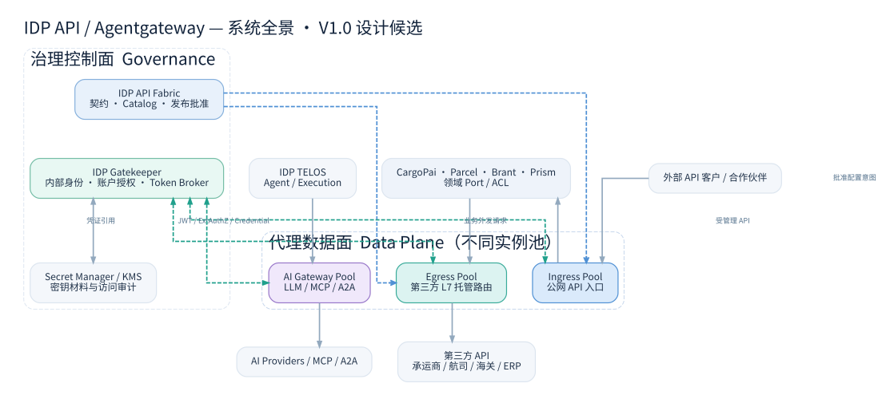
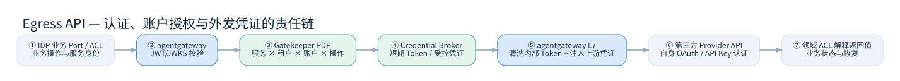
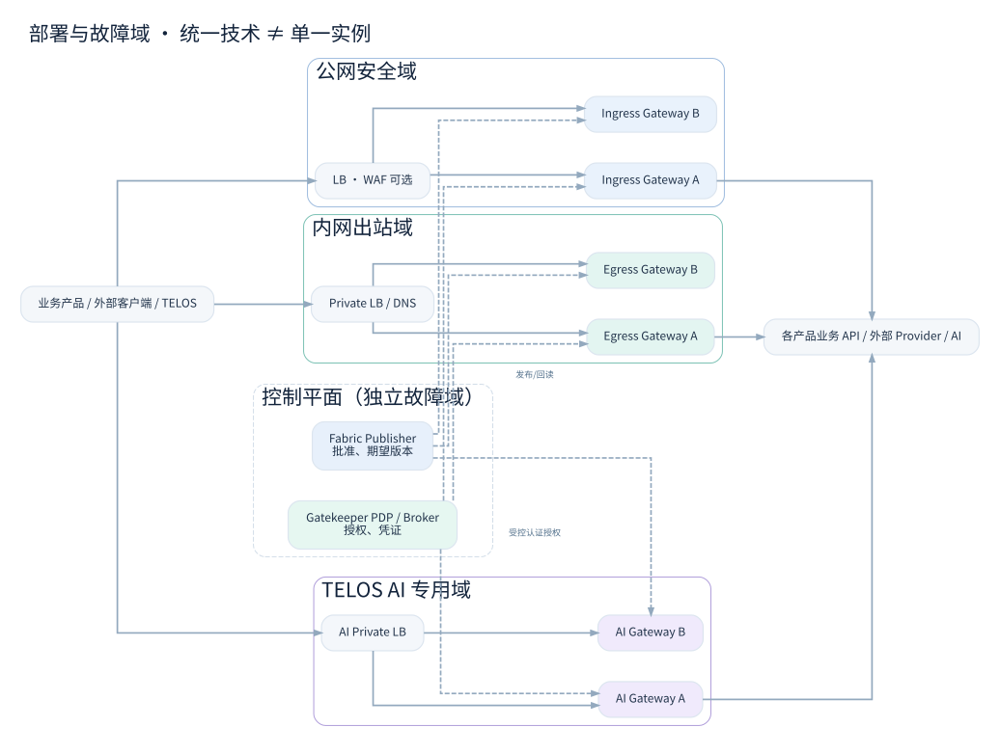

# G02 — IDP Gateway 系统架构、DDD 边界与部署设计

> **编号** G02 · Architecture · **版本** V1.0 · 2026-11-10 · **状态** DESIGN_DRAFT / 架构批准 NOT_RUN  
> **关联** G01 范围、G03 路由、G04 安全、G05 工程、G06 验收；上位标准 IDP-SCG-STD-001。

## 0. 不可混淆的三个平面



- **Governance Plane — IDP API Fabric**：Provider/Consumer API Catalog、不可变契约版本、Release/PublicationSlot、审核与门户，**不参与正常 API 请求转发**。Fabric 的 `PublicationSlot = Target × APIAsset` 不等于 Gateway 的路由资源；必须通过明确的绑定关系和受控发布适配。
- **Identity & Credential Control — Gatekeeper**：内部 IdP/信任、公私客户端身份、服务身份、账户授权、第三方凭证登记、Token Broker；Secret Manager/KMS 保护密钥。**凭证控制面不是业务转发数据面**。
- **Traffic Data Plane — agentgateway**：公网入站、内部外发、AI 流量的代理实例与策略执行；不拥有业务事实，不承担跨系统业务编排。
- **Business Plane — CargoPai、Parcel、Brant、Prism、TELOS**：领域事务和对象级授权，Port/ACL 负责外部领域语义解释。业务产品之间的互调不默认集中到 Egress Gateway。

## 1. C4 Context 与信任边界

| 参与者 | 访问 Gateway 的目的 | 边界与权威 |
|---|---|---|
| 外部客户/合作伙伴 | 调用已授权业务 API | Gatekeeper 的登录/服务身份；业务服务仍检查订单/运单对象授权 |
| 内部业务 Workload | 调用第三方 Consumer API | 工作负载身份 + 租户/账户/操作授权；不信任客户端自行提供的身份 Header |
| TELOS AI Workload | 调用 LLM/MCP/A2A | 专用协议策略、单独实例池；AI 工具权限另由业务/AI 域治理 |
| Fabric Publisher | 提交经过签核的路由/策略变更意图 | Fabric 管发布批准，Gateway 适配器管理实际应用和对账 |
| Gatekeeper | 向 Gateway 提供 JWKS、ExtAuthZ、Credential Grant | 明确认证通信与信任链；Token Broker 不成为开放密钥接口 |
| 外部 Provider | 接收 Gateway 代理调用 | Provider 自己签发/接受 Token；接收前必须移除 IDP 内部 Token |



## 2. 模块边界（DDD 不等于全组件领域化）

建议采用 **最小独立 Context**：

| 上下文 / 模块 | 拥有的事实及职责 | 不拥有的事实 | 对外接口 |
|---|---|---|---|
| Gateway Configuration（工程控制） | `RouteBinding`、`GatewayPool`、`PolicyBundle`、`DeploymentSnapshot`、`ObservedRevision` | API 契约 Release、第三方账户私钥 | GatewayConfigIntent、ReconcileStatus |
| Gatekeeper External Credential（领域能力） | `ExternalProvider`、`ProviderAccount`、`CredentialReference`、`AccessGrant`、`TokenLease` | 具体运单业务状态与 Gateway Proxy 自身规则 | Authz Decision、Token Injection Capability |
| Fabric Registry/Publication | APIAsset、Release、Target×APIAsset PublicationSlot | 运行时代理进程与第三方 Refresh Token | PublishedContractRef、RoutePublicationIntent |
| 业务领域 ACL | Provider → Domain 状态映射、错误语义、业务幂等和业务恢复 | Gateway 部署控制事实 | 自身领域 Port |

**职责约束**：Gateway 可以由 Go 实现配置控制器/适配器，但 agentgateway 数据面不需要也不应被硬套为 Go DDD 领域实体。Bento-Go 是可选的实施组件，未确认当前确切版本前禁止宣称已兼容。

## 3. 权威、模型、不变量

| ID | 不变量 | 验证建议 |
|---|---|---|
| GW-INV-01 | `ExternalProvider` 与 `ProviderAccount` 的 Credential 权威属于 Gatekeeper | 不允许 Gateway/Fabric 建立第二个业务写主 |
| GW-INV-02 | 每条 Egress Route 绑定已批准的 Provider Operation 与 Upstream Allowlist | 拒绝未注册目标和任意 URL |
| GW-INV-03 | 业务请求的租户/主体来自可信 JWT 或工作负载身份 | 不能直接相信 `X-Tenant-ID` 等未验证 Header |
| GW-INV-04 | 授权谓词包含 Service × Tenant × Provider × Account × Operation × Environment | 逐维负向测试 |
| GW-INV-05 | 认证成功不等于业务对象授权成功 | 真实业务 API 进行对象级权限检查 |
| GW-INV-06 | 版本只有在实际观察与批准一致时标记 ACTIVE | 故障/部分应用不得假报成功 |
| GW-INV-07 | Non-idempotent 写请求不在代理层默认重试 | 超时/断连模拟及提交计数 |
| GW-INV-08 | Gatekeeper 对外业务 Secret 不下发给一般客户端 | 检查日志/Header/配置泄露 |
| GW-INV-09 | Private/API Console 与 Public Developer Docs 访问权限独立 | Fabric 内容读授权与运行时 API 调用权分开 |
| GW-INV-10 | 不同网关池共用技术标准，不共享不受控密钥/故障域 | 故障注入和密钥库存核查 |

**最小候选数据模型**：

```text
GatewayPool(id, zone, environment, runtime_version, desired_digest, observed_digest)
RouteBinding(id, pool_id, api_asset_id?, target_id?, provider_id?, operation_id, hostname, path_match, methods)
PolicyBundle(id, version, policy_digest, issuer, audience, authz_profile, egress_constraints)
DeploymentSnapshot(id, pool_id, digest, approved_by, approval_ref, created_at, status)
ReconcileObservation(id, snapshot_id, instance_id, observed_digest, health, timestamp)
```

字段均为**逻辑候选**，不替代现有 Fabric/Gatekeeper 的权威模型；`api_asset_id` / `target_id` 只是跨域引用，不能随意外键到另一产品数据库。

## 4. 三条流量路径

**A 公网 Ingress**：`Client → WAF/Edge（按需）→ Ingress agentgateway Pool → CargoPai / Parcel API`；验证来自 Gatekeeper 的身份；产品保留业务授权。不能把“查看 API 文档”的 Grant 直接当成生产调用权限。

**B 内部 Egress**：`Product Port/ACL → Egress agentgateway Pool → Provider API`；Gateway 只代理已登记的 Provider/Operation，并与 Gatekeeper 的 Credential Broker 协作。对于非 HTTP 协议需经产品特定 Connector 或网络出口策略；不是所有 TCP/EDI/SFTP 都必须通过这条路径。

**C AI traffic**：`TELOS HOST/Execution → AI agentgateway Pool → Model/MCP/A2A`；Agent 执行/Tool 审批由 TELOS 或对应领域负责，不依赖 Gateway 自己完成所有 AI 授权。

**D 内部服务间调用（不是以上三条）**：按信任域使用 mTLS / 服务身份及端到端授权。需要统一服务流量治理时可另立 Internal Gateway 池的明确决议，而不是悄然将所有内部流量导向 Egress。

## 5. 部署拓扑、故障域和环境



- 独立 `ingress-prod`、`egress-prod`、`ai-prod` 以及相应 Test/Dev；每池多副本、独立凭证和网络访问规则。
- 内部 Egress 仅开放受认证的内网入口；其出站网络设置应限制上游域名及目标 IP/端口。各区域采用各自负载均衡，非全局统一单实例。
- 生产变更必须固定 agentgateway 镜像 digest、外部授权服务版本与配置摘要，先在隔离池预发布再逐步提升流量。
- 网络上只能访问批准的第三方 Upstream 或内部受控服务；对于重定向、DNS 重绑定、内网 IP 与 IPv6 映射必须跨应用及网络层验证。
- Runtime 可使用最后一份**有效且未被安全撤销**的配置继续服务，但动态强制授权缺失时仍按风险策略拒绝，不用“配置可用”推导“授权可用”。

## 6. 技术拓扑及协议约束

agentgateway 1.7.x 官方提供 HTTP/TCP 路由、JWT/JWKS、ExtAuthZ、Backend Authentication、HTTP CONNECT Egress、LLM/MCP/A2A 等能力。**技术功能存在 ≠ 在我们选定部署形态下完成验证**。不同安全模型必须按协议逐项实测：

- **显式 L7 HTTP Routing**：代理能够处理方法/路径/Header、Header 清洗/受控上游 Token 注入，是第三方账户委托访问的默认候选。
- **CONNECT Tunnel**：在保持 TLS 端到端加密时不具备完整 HTTP 报文可见性；不能承诺执行任意 Header 注入或 URI 级 API 权限。官方说明 Tunnel/Route 模式应用策略不同，需要分别测试。
- **gRPC**：跨协议元数据、流式行为、状态码、限流、授权在所选 agentgateway 版本和入口模式下执行实测，不能将 REST 测试等价为 gRPC 通过。

## 7. 同步依赖、失败语义与恢复

| 依赖故障 | Ingress | Egress | 责任和恢复 |
|---|---|---|---|
| Fabric 不可用 | 已有安全配置继续执行 | 已有安全配置继续执行 | 不允许未经批准的新发布；对账任务待恢复 |
| Gatekeeper JWKS 不可达 | 有效 JWKS 缓存可按批准 TTL 继续；否则拒绝 | 同理 | 密钥轮换/撤销必须具备有效边界 |
| Gatekeeper ExtAuthZ 不可达 | 对需实时策略的调用拒绝 | 对第三方账号操作拒绝 | 不做“服务不可用=允许” |
| Token Broker 不可达 | 不影响无需第三方凭证的入站路由 | 无有效授权 Token 则拒绝 | 允许受控 Token 缓存但须遵守撤销窗口 |
| Provider 超时 | N/A | 返回 `UPSTREAM_TIMEOUT` 或 `UNKNOWN_OUTCOME` | 非幂等操作由领域对账，不在 Gateway 自动重试 |
| 配置部分分发失败 | 不假报全池生效 | 不假报全池生效 | 对账、暂停新流量或回滚至受控版本 |

## 8. 架构依赖治理与 ADR

参照 `docs/adr/ADR-0001` 至 `ADR-0007`（均为 **Proposed**），由架构/安全/业务/运维具名批准后才能转为 Accepted。参考上游官方文档的 URL 见 G05 末尾。G02 为设计基线，不得被理解为已存在真正部署的 Gateway/Gatekeeper/Token Broker。


## 9. Gateway Operations 管理界面架构补充（G02 · V1.0 同版更新）

Gateway Operations 是 IDP 内部工程门户的导航/体验模块，不是新的 DDD 业务平台，不保存第三方授权权威数据或拥有网关配置发布权威。推荐采用后端 BFF/Read Model 聚合多来源投影，不将 agentgateway 原生管理 API 直接暴露浏览器。管理界面经 Gatekeeper OIDC 登录，执行服务端授权及租户、产品、环境数据域过滤。

```text
IDP Engineering Portal / Gateway Operations
       │ OIDC / role / audience / tenant scope
       ▼
Operations BFF / Read Models
  ├─ Gateway Runtime Observability (read-only)
  ├─ Gatekeeper Policy Projection (read-only)
  ├─ Fabric API / Publication Context (read-only + approved intents)
  └─ Gateway Config Controller (approved release execution only)
```

展示来源与治理权威保持独立；不可让 Portal 成为第二份 Source of Truth。18 页导航中的六个核心管理视图详细边界见 [UX 规格](../portal/spec/Gateway_Operations_UX_Spec_V1.0.md)。


## 同版设计增补：统一 Gateway Console

架构修订：统一前端 IDP Gateway Console 可呈现 Gateway、Gatekeeper 与 Fabric 的只读投影，但三者控制权仍独立；禁止从不同 UI 并行直接写入相同生产网关配置。

详情参见 `portal/spec/Agentgateway_UI_Capability_Matrix_V1.0.md`（自本工程根目录）。


## 11. P0/P1 缺口修复后的架构职责与故障域

### 11.1 五个明确隔离的运行角色

| 部件 | 唯一职责 | 禁止的耦合 | 故障边界 |
|---|---|---|---|
| IDP API Fabric | 合同与治理审批权威，签发已批准路由意图 | 实时流量转发、第三方 Token 签发 | 不在数据面同步关键路径 |
| Gateway Publisher（Go） | 中立 Intent 预检、原生编译、不可变 Snapshot、CAS、Canary、Observed 对账 | 直接读取生产凭证明文、绕过审批 | 控制面故障不影响已经获授权的有效数据面快照 |
| Gatekeeper PDP/Broker | 身份/委托链验证、账户授权、Token/Signer 使用批准 | 业务报文/领域状态转换 | 高风险授权失联 fail-closed；Broker 池独立隔离 |
| agentgateway Egress/Ingress/AI | 受控代理、校验与策略执行、最小权限注入、运行观测 | 业务领域逻辑、通用集成编排 | 每种流量分池；账户/上游需额外隔离 |
| DDD 领域 Port/ACL | 业务语义、第三方响应解释、写操作对账 | 直接持有 Secret、伪造 Gatekeeper 权威 | 领域故障不回写 Gateway 控制面 |

### 11.2 发布、租户及诊断不是一个单体事务

- `Fabric Release` ≠ `Gateway Desired Snapshot` ≠ `Applied Snapshot` ≠ `Observed Revision`；对账失败时继续保留 `PARTIAL/UNKNOWN`，绝不自动显示 ACTIVE。
- Gateway 访问外部 Provider 的 CredentialUse 决策至少绑定：已验证的 Caller、Tenant、DelegatedUser（适用时）、Route、Operation、ProviderAccount、Environment、PolicyVersion 与 RevocationEpoch。
- 出站域名预检只能检查静态文本与配置；运行时 IP 地址段、DNS 重解析、跳转、IPv4/IPv6、SNI/Host 保护必须交由网关+网络边界联合实施并实测。
- 诊断采集是安全敏感的数据流：批准 CaptureRequest → 有界取证 → 源端脱敏 → 安全存储 → 服务端 ABAC 查询/导出审计 → TTL 删除。默认只保留元数据。
- 原生 UI、Console 和 Fabric 不允许同时直接写同一套运行时配置；需要受控 break-glass 流程以及事后自动对账。

**部署状态**：这些是需要实施的结构，不代表 Gateway Publisher、Broker 或 Data Plane 已部署。
