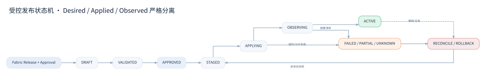

# G03 — 路由、配置发布与流量策略治理

> **编号** G03 · Routing & Configuration Governance · **版本** V1.0 · **状态** DESIGN_DRAFT / Runtime compatibility NOT_RUN  
> 文档约束：API Fabric 负责治理批准；Gateway 适配器负责 agentgateway 运行配置编译/应用；Gatekeeper 保有账户/凭证授权权威。所有例子仅是候选接口与沙箱配置。

## 0. 设计目标与系统事实

**统一地址不是开放代理**：业务产品调用逻辑入口 `https://egress-api.idp.internal/providers/{provider}/...`（规划占位），Router 查找已登记 Provider Operation；任何用户输入目标 URL、Host、IP、端口的接口都不纳入 MVP。地址仅是名字空间，绝不能由字符串拼接推导上游 URL。

**单一配置事实权威**：Gateway 的正式 Desired Snapshot 由受控 Gateway Config/Publisher 持有，引用 Fabric 的批准记录。运行时 agentgateway 的观察状态仅是 Applied/Observed Evidence，不是另一个可变批准源。Fabric API Catalog 的文档可见性不自动转换为运行时 Route 可用性。



## 1. 配置资产模型

| 资产 | 意义 | 权威/更新方式 | 关键约束 |
|---|---|---|---|
| `ProviderRegistration` | 服务提供商标识和环境归属 | Gatekeeper/治理登记分工需确定 | 不包含秘钥明文 |
| `ApiOperation` | API 方法、路径、输入输出契约 | Fabric Consumer API Catalog | 第三方接口契约不由我们伪造为权威 |
| `RouteIntent` | 哪个入口/路径允许访问哪个 Provider Operation | Fabric 受控发布意图 | 唯一 ID、显式环境与 APIAsset 引用 |
| `TargetAllowlist` | 上游 host、SNI、端口、路径/方法边界 | Gateway 治理资源 | SSRF 默认拒绝；只允许已核准目的地 |
| `AuthnProfile` | 客户端身份认证方式 | Gatekeeper 与 Gateway 双方签名/适配 | issuer/audience/algorithm 不允许通配 |
| `AuthzProfile` | 访问权限检查规则 | Gatekeeper PDP | 多维账户/操作/租户范围 |
| `CredentialBindingRef` | 如何选用第三方凭证 | Gatekeeper 负责实际授权和 Token | Gateway 不直接存放原始第三方私钥 |
| `PolicyBundle` | 限流、超时、Header 清洗、网络规则组合 | Gateway Publisher | 内容可哈希、可复现、可回退 |
| `DeploymentSnapshot` | 一次完整已批准配置制品 | Gateway Publisher | 只追加、不可变、带审批依据 |
| `ObservedState` | 各运行副本真实摘要与健康 | Gateway Reconciler | 与批准状态不得混淆 |

参考结构：`contracts/gateway/route-intent.schema.json` 和 `gateway/policies/egress-policy.example.json`。这些是我们的**中立意图模型**，不是 agentgateway 原生命令格式。

## 2. 路由解析规则

**Ingress**：按域名、已批准路径、方法、可选 Header 及权重匹配，不允许公共路径吞并内部管理路由；先 TLS/客户端验证，再授权、再请求转发。API 请求对业务对象的最终权限在业务服务验证。

**Egress**：按 `provider_id + operation_id + environment` 解析固定 Upstream；账户标识由 Gateway 可信上下文和 Gatekeeper 授权解析。Provider Account 可不出现在 URL；若出现，也只是申请使用的 ID，必须重新授权。任何主机名替换、跨环境或重定向改变目的地都需重新匹配允许目标。

**AI**：TELOS 流量使用独立网关实例和独立策略；MCP/A2A 版本、安全握手和 Tool 访问权限不得用 REST 通用授权替代。

### 2.1 L7、CONNECT 与 gRPC 的选择

| 模式 | 可见/可控的内容 | 典型用途 | 本期要求 |
|---|---|---|---|
| L7 托管 HTTP(S) Route | HTTP 方法、路径、Header 及请求级策略 | 第三方 OAuth/API Key 按账户选择并注入 | **P1 必测** |
| CONNECT Tunnel 透传 | CONNECT 目标、TLS SNI；内部 HTTPS 内容不可见 | 出口域名白名单、网络代理 | 可选，不作为动态 Token 注入依据 |
| CONNECT Route Mode | CONNECT 请求的 HTTP 策略，隧道中真实 HTTPS 内容通常仍不可见 | 出站连接级认证与路由 | 单独验证，不宣称等同 L7 |
| gRPC L7 Route | Metadata、Method、状态、流控取决于实现/版本 | 对外 gRPC | P1/P2 单独验证 Unary/Streaming |

官方对 CONNECT 两种模式的策略差异有明确说明；见文末官方资料链接。**禁止**用只验证 CONNECT 白名单的测试结果推导“可以替第三方 HTTPS 注入 Header”。

## 3. 配置发布状态机

```text
DRAFT → VALIDATED → APPROVED → STAGED → APPLYING → OBSERVING → ACTIVE
  │        │          │         │         │          │           │
  └─REJECTED / CANCELED   └──FAILED / PARTIAL / UNKNOWN──RECONCILE/ROLLBACK
ACTIVE → WITHDRAW_REQUESTED → REVOKING → REVOKED
ACTIVE → SUPERSEDED（被更新的 ACTIVE 发布取代，含回滚发布）
```

状态语义：

- `APPROVED` 是授权发布的事实，不意味着 agentgateway 已接收配置。
- `STAGED` 表示已生成目标版本且签名/静态检查通过，并非已生效。
- `APPLYING` 向目标池开始发布，部分实例成功时记录 `PARTIAL`。
- `OBSERVING` 各实例回读摘要和健康；在所有预期实例达到规定健康策略前不标 ACTIVE。
- `ACTIVE` 必须包含 `snapshot_digest`、已完成的观察证据和目标池集合。
- `ROLLBACK` 创建新受控事件，指向上一个已批准有效 Snapshot；不得静默篡改历史。
- 凭证撤销属于独立安全状态，不能因为旧路由配置仍有效就允许访问被撤销账户。

## 4. 发布算法与并发一致性

1. Fabric 发出具名已批准 `RoutePublicationIntent`：信封携带 `idempotency_key/release_ref/target_id`，内嵌的 `intent`（RouteIntent）携带 `approval_ref/expected_generation` 与 API 资产引用（`api_asset_ref` 或 `contract_ref`）；契约见 `contracts/fabric/route-publication-intent.openapi.yaml`。
2. Gateway Publisher 服务端复核调用主体权限、来源和签名/可信通道，不把任意客户端的 Approval Flag 当权威事实。
3. 将结构化意图与受控策略仓库合成完整 Snapshot；校验引用存在、上游目标白名单、TLS 要求、JWT 绑定、Header 策略及敏感字段。
4. 产生确定性内容摘要，采用 CAS/乐观版本切换 Desired Generation；保存不可变制品和审计。
5. 先在受限 canary pool 验证，再按批次应用到副本；记录 `deployment_id, instance_id, desired_digest, observed_digest, health, apply_time`。
6. 健康与一致性条件满足才标 `ACTIVE`。超时不认定失败或成功，标记 UNKNOWN 后 Reconcile。
7. 对安全严重变更（撤销、Block）即刻触发拒绝策略/隔离，不应等待普通发布慢速最终一致；若达不到撤销窗口，阻断影响范围。

**一致性**：跨 Fabric/Gateway/Secret Manager 不宣称单事务 Exactly Once。使用幂等命令 + 乐观版本 + Outbox/持久工作队列 + 对账，补偿不能伪造已发生的外部请求从未发生。

## 5. Header、URI 与转发契约

**入站允许**：仅按提供商允许的 HTTP Headers 传播 `Content-Type`、业务 Idempotency-Key 等；`Traceparent` 保持关联但清洗不受信任的 `Baggage`；禁止将 `Authorization`（IDP JWT）、`Cookie`、`X-Forwarded-*` 等未经边界验证的身份标头传给第三方。

**出站生成**：Provider Access Token 或签名只能由通过授权的 Credential Broker / Gateway 可信组件附加。`Host`/`:authority`/SNI 严格匹配批准上游，防止 Host header injection。第三方响应中的 `Set-Cookie`、跳转和 Hop-by-Hop Header 按 API 契约单独处理，不可无条件向业务客户端暴露。

**URI 改写**：逻辑 URI 与 Provider URI 的映射属于配置策略；Path 编码、百分号、双斜线、点段、尾斜线、Query 重复键都必须有负向用例。任何上游重定向不允许绕过原目的地验证。

**写操作**：禁止 Gateway 默认对 POST/PATCH 以及其他无幂等保证操作进行自动重试；允许 Idempotency-Key 只代表业务协议和提供商确实支持，不能因 Header 存在就认定安全。

## 6. 限流、熔断与实时授权策略

按 `pool → provider → provider_account → tenant/service → operation` 定义配额域。全局限流依赖专门协调服务时，必须验证多副本一致性和协调器故障行为；本地限流不可被标记为全局精确配额。`429` 必须明确来源（Gateway/Provider），勿把供应商余额和内部配额混为一谈。对 ExtAuthZ 高风险操作以 fail-closed 为默认；读取缓存允许使用时间窗必须由安全负责人批准，且缓存键包含全部授权输入。

## 7. 示例资产与检查方式

- `gateway/config/agentgateway.local.example.yaml`：基于官方路由形态的本地**占位样例**，仅使用 loopback upstream，已通过 agentgateway 1.6.0 `--validate-only` 语法检查但从未启动；实际运行过的配置见 `poc/p1/agentgateway.poc.yaml`。
- `contracts/gateway/route-intent.schema.json`：中立 RouteIntent JSON Schema。
- `gateway/policies/egress-policy.example.json`：经过显式枚举的 Provider Operation 白名单示例。
- `scripts/validate_baseline.py`：离线 JSON/YAML/Markdown 与示例静态检查，不代替官方配置 schema 或运行时验收。

## 8. 资料来源与证据界限

- [Agentgateway Routes](https://agentgateway.dev/docs/standalone/latest/documentation/configuration/routes/)
- [Agentgateway Egress Proxy](https://agentgateway.dev/docs/standalone/latest/documentation/configuration/egress-proxy/)
- [Agentgateway Update Config](https://agentgateway.dev/docs/standalone/latest/documentation/setup/update/)
- [Agentgateway ExtAuthZ](https://agentgateway.dev/docs/standalone/latest/documentation/configuration/security/external-authz/)

这些资料证明配置能力的**官方描述**，不证明我们的 Runtime 版本、配置及多租户方案已通过兼容性或安全测试。


## 9. 管理页面与发布操作语义（G03 · V1.0 同版更新）

Routes 页面仅展示 RouteIntent/Observed Config 的差异与配置来源。Config Releases 页面必须显示发布 **期望 Revision**、各实例 **观察 Revision** 和回读确认结果；只有 Reconciler 确认完成才能标识 ACTIVE。待审批的变更不允许由 UI 直接提交到 agentgateway 配置接口。

发布状态只有一套词表，即 §3 状态机与契约中的 `ReleaseState`；Console 上的 REVIEW（= VALIDATED 待审批）、ROLLOUT（= STAGED/APPLYING/OBSERVING）、RECONCILED（= ACTIVE）、REVERTED（= 回滚发布到达 ACTIVE，被取代者为 SUPERSEDED）只是 `ReleaseState` 的展示标签，不是额外状态。高风险操作需具名审批、职责分离、乐观版本检查、Idempotency-Key 和独立审计。离线原型仅模拟部分状态转换，不等同真实状态机实现。见 [UX 规格](../portal/spec/Gateway_Operations_UX_Spec_V1.0.md)。


## 同版设计增补：统一 Gateway Console

交互原则：可视化接入向导输出版本化的 RouteIntent；部署前执行配置 Schema 检查、路由冲突检查、租户授权校验和发布影响分析；Raw Configuration 仅用于受控诊断和批准流程。

详情参见 `portal/spec/Agentgateway_UI_Capability_Matrix_V1.0.md`（自本工程根目录）。


## 10. RouteIntent V1.0 分支、预检与原生配置之间的明确边界

`contracts/gateway/route-intent.schema.json` 现采用 `oneOf` 处理三类流量：

| 流量 | 专属输入 | 不能继承的字段 | 运行时风险 |
|---|---|---|---|
| `INGRESS` | `public_hostname`,`backend_service_ref`,`api_asset_ref`,`allowed_methods` | 外部 Provider 凭证与 AI Target | 公网控制台/管理路由穿透、对象级鉴权遗漏 |
| `EGRESS` | `provider_id`,`operation_id`,`upstream_hostname/port/TLS`,`credential_binding_ref`,`redirect_policy=DENY` | 公网后端服务或 AI Target | SSRF、跨租户 Token、账户配额争抢 |
| `AI` | `ai_protocol`,`ai_target_ref` | 普通第三方凭证绑定 | MCP Tool 认证和 Agent 信任不同于 REST |

`HEAD` 与 `OPTIONS` 已纳入允许方法枚举，但实际 CORS/预检放行不得仅因方法在列表里就绕过认证策略。示例覆盖三个分支，负例见 `tests/contracts/invalid-route-intents.json`。

新增 `scripts/preflight_intents.py` 执行中立契约验证、典型非法上游字符串检查及完全重叠的路由冲突检查。**不能作为安全边界**：它不执行 DNS 查询、不识别所有 Path/Regex/优先级歧义、也不生成经过 agentgateway Schema 验证的运行配置，输出 `STATIC_PREFLIGHT_OK_NOT_DEPLOYABLE`，禁止直接发布。

### 10.1 真实发布流水线强制阶段

1. 读取已批准、具名、具权限的 Intent；CAS 校验 expected_generation。
2. 预检模型与引用、上游网络许可和租户权限；拒绝重叠路由或不确定优先级。
3. 使用固定版本映射器编译到 agentgateway native config；由其对应版本 Schema + CLI + 启动检查执行**真实兼容性校验**。
4. 构建包含镜像 digest/原生配置 hash/策略版本/审批 ID 的不可变签名 Snapshot。
5. Canary → 分批发布 → 实例回读与健康判定；不能以“写入配置文件成功”代表已生效。
6. 部分失败记录真实副本清单和 `PARTIAL`；回滚仅指向先前已批准快照，仍需再次观察健康及授权拒绝效果。
7. 安全撤销、强制封禁与正常配置发布分开：最迟生效时限和失败策略必须具名批准。

### 10.2 ProviderAccount 流量与健康策略（正式设计）

`gateway/policies/traffic-policy.schema.json` 规定配额维度、协调方式、超时、并发、连接和熔断意图。运维应看到 `gateway_429` 与 `provider_429` 不同来源。

- 单 ProviderAccount 的共享额度，应按账户硬上限与各租户/应用子配额同时判断；对全局一致性有要求的场景使用经验证的协调器。
- 协调器不可用，必须按配置明确 `REJECT` 或保守本地上限，绝不无上限放行。
- 针对供应商返回 429，应读取和验证合法的 `Retry-After`/配额响应；不应把本地限流机制假称供应商配额权威。
- 熔断/健康检查必须区分连接错误与正常业务 4xx；不得因正常权限拒绝触发整家供应商下线。
- 写操作重试一律须业务幂等和供应商契约批准，不得因 Gateway timeout 自动重放。

### 10.3 协议兼容矩阵

参考 `tests/protocol-compatibility.csv`，各能力的执行状态初始为 `NOT_RUN`。对 gRPC 需测 HTTP/2、unary、client/server/bidi streams、metadata/trailer/status；对 HTTP 测 chunked、SSE、二进制、大包、HEAD/OPTIONS、路径规范化和编码；超时取消和连接清理亦需验证。支持清单应随 agentgateway 镜像 digest 固定。


## 请求 / 响应映射的证据和变更边界

每次受管 L7 代理调用视作两个逻辑通信 Hop：`Caller ↔ Gateway` 与 `Gateway ↔ Upstream`。Gateway 能够改变外发 Request 的目标路径、Host、Header、认证材料，以及返回给 Caller 的 Response 状态、Header 和错误体。因此仅展示“第三方 HTTP 200”不足以判断客户端是否收到了 HTTP 200；两条 Hop 必须分别呈现 Request 与 Response，并在单一 Trace 下关联。

- 采集阶段必须声明是**转换前还是转换后**的报文；请求签名、凭证注入、编码与代理转码的顺序必须通过固定 agentgateway 版本的真实 PoC 验证。
- `NOT_SENT` 表示网关确认未进行上游发送；`NOT_OBSERVED` 仅表示观测不到响应，不等于上游业务未执行。
- 路径重写、敏感 Header 删除、Provider Request ID 与客户端 Correlation ID 应形成脱敏差异摘要。不能从默认 Access Log 推导原始 Request/Response Body。
- 对响应改写必须保留业务领域的解释权：Gateway 允许协议/安全错误规范化，领域 ACL 负责业务语义和幂等恢复。
