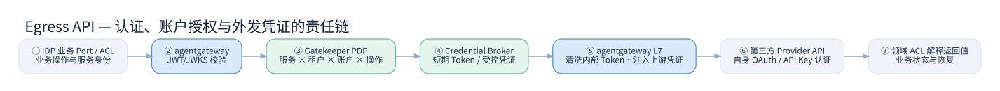

# G04 — 统一认证、第三方凭证治理与多租户安全

> **编号** G04 · Identity, Authorization, Credential Security · **版本** V1.0 · **状态** DESIGN_DRAFT / Threat Model Proposed / PenTest NOT_RUN  
> **重大约束** Gatekeeper 为身份与授权权威；Secret Manager 管密钥材料；agentgateway 为 PEP 和可信上游认证执行点，不是任意第三方 Token 的发行方。

## 0. 核心安全判定

**三道不可混淆的判定**：

1. **Caller Authentication**：IDP Workload/外部客户端是谁？JWT/JWKS/mTLS 校验证书及信任发行方、audience、有效期、算法等。
2. **Access Authorization**：这个 Caller 能否对指定租户、Provider、Account、Operation、Environment 发出请求？由 Gatekeeper PDP 判定，Gateway 执行。
3. **Upstream Authentication**：外部 Provider 如何认可我们？API Key、OAuth Client Credentials、授权码 Token、HMAC、mTLS、签名等由其自己定义；Gatekeeper Credential Broker 管理可用授权凭证，Gateway 按经批准的模式使用。

**禁止的捷径**：仅验证 IDP JWT 就放行全部 Provider；相信 `X-Account-ID` 或 `X-Tenant-ID` 作为授权事实；把内部 IDP JWT 原样传给 FedEx；把第三方 Secret 广泛下发给每个业务服务。



## 1. 信任域与参与主体

| 主体 | 身份权威 | 访问权限 | 密钥 / Token 规则 |
|---|---|---|---|
| IDP 服务身份 | Gatekeeper 的服务认证或外部受信任工作负载身份 | 限定产品、租户与 API 操作 | 内部 JWT 仅用于 IDP 信任域 |
| 外部 API 客户 | Gatekeeper/联合 OIDC | 产品与合同允许的 API | Gateway 验证后业务仍做对象级授权 |
| Gateway 工作负载 | 独立网关工作负载身份 | 仅可调用受控 PDP/Broker 和上游 | 不存全局全量明文凭证 |
| Gatekeeper PDP | Gatekeeper | 决定主体与外部 Account Grant 的关系 | 决策来源必须含可信 Caller Context |
| Credential Broker | Gatekeeper 独立能力 | 仅授权代理使用对应 Provider Secret | 返回受限凭证用途或瞬态 Token；防滥用 |
| Secret Manager / KMS | 独立密钥权威 | 以工作负载最小权限访问密钥 | 使用审计、版本轮换、环境隔离 |
| 外部 Provider | 其自身认证服务器 | 按其授予 Scope/账户权限 | IDP 不能擅自签发 Provider Token |

## 2. Gatekeeper 最小扩展模型

**候选逻辑对象**：

```text
ExternalProvider(provider_id, auth_mode, issuer?, environment_profiles)
ProviderAccount(account_id, provider_id, tenant_id, environment, status)
CredentialReference(credential_id, account_id, secret_ref, version, rotated_at)
ExternalAccessGrant(grant_id, principal_id, tenant_id, provider_id, account_id,
                    operation_ids, scopes, valid_from, valid_to, status)
TokenLease(lease_id, account_id, oauth_client_id, audience, scope_set,
           token_fingerprint, expires_at, refreshed_at)
```

- ProviderAccount 和 CredentialReference 明确分离；`secret_ref` 是安全存储引用而非密钥明文。
- AccessGrant 必须绑定 **真正通过认证的 Caller Identity**；`tenant_id` 不能独立自客户端任意 Header。
- TokenLease 是受控缓存事实，不是 Provider 的权威授权状态；撤销后不能因为 Lease 未到期就忽略撤销策略。
- 对外展示只能是脱敏账户元数据（后四位/别名），不暴露 Bearer Token、客户端密钥和私钥。
- 不同客户共用同一物理 Provider 账户时必须明确共享授权合同边界，不得默认跨租户共享。

## 3. 判定函数与策略

```text
ALLOW = TrustedCaller ∧ AudienceValid ∧ TenantBound ∧ ActiveGrant ∧
        ProviderAccountActive ∧ EnvironmentMatch ∧ OperationAllowed ∧
        RouteAllowlisted ∧ CredentialAllowed ∧ NoExplicitDeny
```

`UNKNOWN / INDETERMINATE` 对于凭证使用、非幂等操作、客户隐私 API 均拒绝。统一鉴权优先在 Gateway 前端执行，并在选定上游后必要时做 Backend-level ExtAuthZ 以限定上游账户。**不得仅因为 ExtAuthZ 允许，就在上游路由改变后继续使用前一账户的 Token**。

**AuthZ 输入来源**：`principal` 只能来自已验签身份与可信服务间通道，`tenant/account/operation` 由 Route Registry、令牌绑定和 Broker 的权威数据共同求得；若 Adapter 提交 `account_id`，视为待校验申请而非事实。`scope` 必须满足实际目标 API 的最小权限，不得由调用方任意提权。

**授权缓存**：如果采用 Envoy gRPC extAuthz 缓存，官方特别提醒缓存 Key 包含全部决策使用的属性；Token、租户、目标账户、路由、操作、环境、策略版本、撤销代次都应评估。高风险请求初期关闭跨请求决策缓存或采用极短有效期并验证撤销传播。HTTP ExtAuthZ 与 gRPC ExtAuthZ 缓存能力不相同。

## 4. 第三方凭证与 Token 生命周期

**Client Credentials**：Gateway / Broker 使用相应 Provider 授予的 OAuth Client 认证并从该 Provider 获取 Access Token；不能把内部 JWT 直接交换成第三方 Token，除非第三方正式支持 RFC 8693 Token Exchange 或其他指定授权协议。Token 缓存键至少包含 Provider × Account × Environment × Client × Scope/Audience × Secret Version；并发刷新采用 Singleflight/租约，失败不得复用已撤销的 Token。

**API Key**：存储在 Secret Manager；受控 Broker 或 Gateway BackendAuth 引用，不可写入 URI 或普通日志。固定配置内 Key 适合单账户固定路由，不自动解决多租户动态凭证选择。

**HMAC / 签名**：某些 Provider 要求对时间戳、路径、Body 签名。HTTP 代理在路由/重写之后才可能签名最终字节；不允许错误使用改变 Body 后的原签名。需要专用 Provider Signer 时可部署受限 Go 签名适配器，不将任意代码执行机制放入 Gateway 核心。

**mTLS**：客户端与 Gateway、Gateway 与 Provider、Gateway 与 Gatekeeper 是三条不同的 TLS 信任链。证书和私钥保存在独立安全目录/Secret Manager，定期轮换并演练吊销。

**Credential Broker 返回模式（需 PoC 比较）**：

- 模式 A：Gatekeeper 经可信 ExtAuthZ 返回受限 Header 注入信息（可能包含短期 Provider Token）。只允许 Gateway 授权通道处理，必须禁止日志泄密并验证缓存风险。
- 模式 B：Gateway 通过受限本地 Broker/Sidecar 获取 Token 并注入，减少网络传播面，但增加独立部署和通信契约。
- 模式 C：固定 Secret 引用通过 agentgateway BackendAuth；适合固定账户，不适合动态租户账户。
- **P1 PoC 结果**（agentgateway 1.6.0 与 1.7.0 + Mock Gatekeeper/Provider，非正式验收）：模式 A 经 HTTP ExtAuthZ 响应头注入跑通并做到双租户账户隔离，网关到 PDP 为工作负载 mTLS；模式 B 用 Mock 本地 Broker 跑通，隔离相同，代价是多一个持有凭证的本地组件；模式 C 跑通，但所有租户共用同一账户。见 [P1 PoC 报告](../tests/acceptance/blackbox/README.md) 与 [ADR-0008](adr/ADR-0008.md)。

**最初版本不能假设动态凭证插入对所有协议都可原生实现**；必须以真实版本和 extAuthz 回包机制实测，必要时在受控 sidecar 实现，严禁因此开放任意 Header 注入。

## 5. 典型威胁（STRIDE / API Security）

| 风险 | 攻击路径 | 默认控制 | 必验负向场景 |
|---|---|---|---|
| S-01 身份伪造 | 错误 JWT / 篡改 alg/aud/iss | 明确 alg、JWKS、iss、aud、exp/nbf | JWT_FAIL 系列 |
| S-02 租户越权 | 用另一个 tenant_id/account_id 请求 | Trusted identity + 复合授权 | TENANT_CROSS_DENY |
| S-03 账户混淆 | Token 缓存键不包含 Account/Scope | 完整复合缓存键、禁跨账户复用 | ACCOUNT_TOKEN_MIX |
| S-04 SSRF | 指定任意 Host/IP/Redirect/DNS | Provider allowlist、出站网络 ACL、目标校验 | SSRF_PRIVATE_IP |
| S-05 Token 泄露 | IDP Token 被传到外部上游 | 敏感 Header 清洗、日志脱敏 | TOKEN_NOT_FORWARD |
| S-06 重放 | 网关错误重试创建面单 | 非幂等禁重试、领域幂等与恢复 | WRITE_NO_RETRY |
| S-07 策略漂移 | 副本部署不同版本 | Snapshot SHA、Reconcile、隔离未知版本 | DRIFT_BLOCK |
| S-08 Broker 滥用 | 自由请求任何账户 Token | Broker 专用 workload identity、grant、scope 限制 | BROKER_ESCALATION |
| S-09 DNS 重绑定 | 公网域名解析到内网 | DNS/IP 双重校验、网络 egress ACL | DNS_REBIND |
| S-10 错误授权缓存 | 复用他人 Allow 决定 | 完整缓存键/失效策略 | AUTHZ_CACHE_CROSS |
| S-11 供应商重定向 | 302 转到未允许上游 | 禁止自由跟随、重匹配 allowlist | REDIRECT_UNTRUSTED |
| S-12 运行配置泄密 | 配置制品含 Secret | SecretRef、脱敏、加密制品存储 | NO_INLINE_SECRET |

## 6. 信任链断裂和默认失败行为

| 失效 | 允许的行为 | 禁止的行为 |
|---|---|---|
| Gatekeeper JWKS 不可用 | 仅在授权 TTL 内复用已验证 JWKS 公钥，否则拒绝 | 关闭 JWT 校验继续透传 |
| Gatekeeper PDP 超时 | 受控的低风险短期缓存（如明确批准），高风险拒绝 | 将网络错误视为 Allow |
| OAuth Token Expired | 由受控 Broker 刷新，未获有效 Token 则拒绝 | 用过期 Token 强行提交写操作 |
| Secret 被撤销 | 立即停止发放新的 Token；处理既有 Token 撤销窗口 | 无期限使用旧缓存 |
| Provider API 超时 | 返回真实超时/结果未知并让领域处理 | 自动重复提交非幂等操作 |
| 配置生效未知 | 标记 UNKNOWN、启动对账或撤回 | 对运维宣称全池成功 |

## 7. 接口契约与访问矩阵

- `contracts/gatekeeper/openapi.yaml` 定义 Gateway Control API 的建议命令形态，供 OpenAPI 检查及跨域讨论；**不是** Envoy extAuthz 线协议的替代定义。
- `contracts/gatekeeper/authz-decision.schema.json` 是中立决策制品结构与 Mock 的共同输入输出定义，仅用于内部逻辑校验与示例，不承诺 agentgateway 原生接受此 JSON。
- 真实 Gateway ↔ PDP 使用官方 Envoy gRPC ExtAuthZ 或官方 HTTP ExtAuthZ 模式之一，由 `GatewayAuthzAdapter` 将 Gatekeeper 决策安全映射到被验证的协议。
- HTTP ExtAuthZ 2xx 表示允许，非 2xx 表示拒绝；不等于允许把响应 Header 任意插入后端请求。必须按白名单选择输出 Header 并验证具体配置支持。

## 8. 数据保护、密钥运维与审计

审计中保留稳定 `trace_id`、`principal_subject_hash`、`service_id`、`tenant_id`、`provider_id`、`account_ref_hash`、`operation_id`、`policy_version`、`decision_code`、`config_digest`；拒绝记录 Token/Key、密码、PII、未脱敏 Body。审计保留期与区域数据合规按照真实部署法域、客户合同和数据分类在上线前确认，不编造统一全球法定义务。

绝不允许管理 UI/开发者门户的查看权限直接继承为第三方账户使用权。Gatekeeper 授权包含 `principal + action + resource + environment + purpose`，并有时间有效性；紧急吊销变更应具有优先通道和效果验证。

## 9. PoC 必须证明的核心结论

1. 两租户、两 Provider Account 的 Token 隔离；撤销 A 不影响 B，A 不能读/使用 B 的 Token。
2. Gateway 收到内部 JWT、第三方 API 只收到 Provider Token；内网 Hook、Header 不能伪造租户。
3. 同一操作支持固定 Key 和动态 OAuth 两种鉴权，确认 agentgateway 真实兼容路径。
4. HTTP L7 与 CONNECT 在所选模式下具有明确协议能力边界；证书和 SNI 正确。
5. Gatekeeper、Secret、Provider 授权服务器、网关实例分别故障时按默认拒绝与恢复策略执行。
6. 关键授权绕过和 SSRF 用例经过动态负向测试，不能用代码评审替代。

资料： [JWT](https://agentgateway.dev/docs/standalone/latest/documentation/configuration/security/jwt-authn/) · [External AuthZ](https://agentgateway.dev/docs/standalone/latest/documentation/configuration/security/external-authz/) · [Backend Auth](https://agentgateway.dev/docs/standalone/latest/documentation/configuration/security/backend-authn/) · [OAuth 2.0 BCP RFC 9700](https://www.rfc-editor.org/rfc/rfc9700.html) · [JWT BCP RFC 8725](https://www.rfc-editor.org/rfc/rfc8725.html)。


## 10. Gateway Operations UI 安全与权限（G04 · V1.0 同版更新）

- Gateway Operations 必须接入 Gatekeeper OIDC，严格校验管理 UI / BFF 的 Audience 与权限；页面按钮隐藏不是授权措施，全部状态变更必须再次在服务端执行 RBAC/ABAC 决策。
- 建议角色 Viewer / Engineer / Security Reviewer / Operator，明确提案、审批、部署、回滚职责分离；正式权限代码以 Gatekeeper 契约为准，不能让 UI 自定义权限事实。
- Policy 页只读投影第三方账户授予关系，禁止明文读取任何 External Token、API Key、证书私钥、Secret；访问审计不记录敏感头部。
- Trace 必须在后端进行脱敏并按租户/产品/安全域过滤；包括搜索接口、详情、导出、错误信息和审计日志，防止仅前端过滤。
- UI 管理接口不得公网裸露；需要会话管理、CSRF 防护（如使用 Cookie）、严格 CORS/CSP、点击劫持保护、操作二次确认及变更审计。
- Gatekeeper 不可用时高风险操作默认拒绝，不得沿用过期的允许结果。业务网关数据面不得因 UI 停机而停止已有合法流量。

详见 [Gateway Operations UX Spec](../portal/spec/Gateway_Operations_UX_Spec_V1.0.md)。


## 同版设计增补：统一 Gateway Console

管理界面：Gatekeeper SSO + 最小 RBAC/ABAC；原生与 IDP Console 的管理接口均不得匿名暴露；外部账户凭证仅显示引用和授权状态；基于可信服务身份绑定账户。

详情参见 `portal/spec/Agentgateway_UI_Capability_Matrix_V1.0.md`（自本工程根目录）。


## 同版增补：报文诊断数据安全边界

- 认证、授权与凭证可在 Gateway 中运行，但**绝不可默认将第三方 Token、JWT、HMAC 签名材料、Cookie、身份证明、个人地址、医疗/支付等信息写入报文日志**；捕获策略应在采集和导出边界先删敏感字段。
- Gatekeeper 单独决定 `gateway.message.read_sanitized`、`gateway.message.export`、`gateway.diagnostic_capture.manage` 是否允许，结合服务身份、租户、目的、时间范围与数据分级执行；真实授权必须在后端，不以角色下拉框为准。
- 使用不可变审计关联每次报文读取、导出及临时捕获启停；提供保留期、加密、租户级访问隔离、删除与成本上限。导出是另一个授权操作，不是读权限的默认附属能力。
- 需要看外发变更后报文时必须通过安全的捕获路径取得确切事实，不得从原始请求推断 Gateway 确实转发了相同数据。对捕获错误或 ExtProc 故障采用经批准的失败策略，不得静默关闭强制的鉴权/安全策略。


## 11. 多租户 CredentialUse / Token Broker 执行契约与撤销

Gateway 的内部授权与 Provider 认证**是两个不同的交易**。`Gatekeeper PDP` 先确认 Caller+Tenant+DelegatedUser（如有）+ ProviderAccount+Operation+Environment，并签发短有效期决策；Broker 仅接收绑定此决策与网关工作负载身份的 CredentialUse 请求。

| 认证类别 | 原则 | 必须做的负向验收 |
|---|---|---|
| OAuth2 Client Credentials | 向第三方授权服务器请求 Token；缓存按 provider/account/client/scope/audience/env/secret-version 隔离 | 交叉租户、过期 Token、并发刷新、撤销后拒绝 |
| OAuth2 Authorization Code | 处理授权用户/租户委托与刷新令牌保护；禁止用户 Token 自动转换成服务 Token | 不同委托人、过期授权、用户撤销 |
| API Key | 从 Secret Manager 受控引用；只在 Gateway 上游发送阶段附加 | 改 Host/Route/Account 后绝不沿用 |
| HMAC / 私有签名 | 签名确切的**最终外发**方法/路径/query/body/hash；必要时独立可信 Signer | 签名前后 Body 变更、时钟偏移、重放和密钥泄露 |
| mTLS | 客户端证书/私钥仅存于受控工作负载/密钥设施 | 错误证书、链不受信、过期/撤销、跨租户复用 |

`contracts/gateway/policies/credential-binding.schema.json` 是使用授权意图，绝不允许存真实 Token。**不应默认让 agentgateway 原生处理所有类型**；必须经选定版本的真实能力对照，必要时开发独立、只执行最小权限签名/注入的扩展。

**撤销**：账户禁用和 AccessGrant 撤销独立于慢速 Route 发布；必须保证新 CredentialUse 无法越过最新撤销代次。缓存必须绑定 PolicyVersion/RevocationEpoch 并有硬 TTL；对高风险请求默认实时 PDP 判断，PDP/Broker/Secret 不可用时拒绝新增凭证注入，不得自动 fail-open。

### 11.1 业务人员委托与服务身份绑定

- 对用户代表组织调用第三方 API，必须记录已验证的真实 User、Service、Tenant、Authorization Grant 及代理委托范围；没有委托上下文的后台作业须通过明确的服务授权策略，不得伪装成某个用户。
- 客户端 Header `X-Tenant-ID`、`X-Provider-Account`、`X-User-ID` 不能直接成为决策权威。可信上下文由 Gateway 在验签/受保护连接后构建。
- Broker 响应的凭证只能送达受保护 Gateway 执行边界，不得传入业务响应、异常文本、OpenTelemetry Baggage 或普通审计日志。
- 上游路由重写完成后才能确定 HMAC 签名输入；变化后必须重新做一致性判定，防止跨账户复用凭证。

### 11.2 安全按需诊断

`contracts/gateway/policies/diagnostic-capture.schema.json` 与 `contracts/gateway/diagnostic-event.schema.json` 定义 CaptureGrant 与四阶段证据。默认只收集元数据；如需正文，CaptureGrant 必须具备 Route、Tenant、用途、审批人、开始/结束时间、保留期、消息大小上限和脱敏规则，并且**开始时刻严格早于到期时刻**（见离线语义校验及真实服务端验收）。

所有捕获和导出都需要后端 ABAC 与不可变审计；对二进制/gRPC Streaming 只记录有界元数据而不承诺完整正文。开发者无权借由 Agentgateway 原生 UI 或日志绕过这层保护。


## Message Inspector 请求 / 响应成对诊断的安全界限

成对报文展示不是授权的例外。`Request Headers`、`Response Headers`、`Request Body`、`Response Body` 四类证据均需按主体、租户、应用、环境、路由与用途独立授权；前端 Viewer 的按钮隐藏绝不能替代服务端策略校验。

默认不捕获 Body；当审批后采集时，必须在持久化、Telemetry Export、索引和导出前进行字段删除或不可逆脱敏，覆盖 `Authorization`、`Proxy-Authorization`、`Cookie/Set-Cookie`、API Key、Token、Secret、敏感 Query 参数、地址电话和其他 PII。正文采样需按大小、时间和数据类别限制；二进制及流式协议仅展示元数据，除非明确批准受控解码。

任何 `NOT_OBSERVED` 不得替换为“空 HTTP 200”；任何下游 Gateway 生成的 504 不得记录为第三方返回的 HTTP 504。报文的时间戳、采集点位置与脱敏策略版本属于审计证据。
