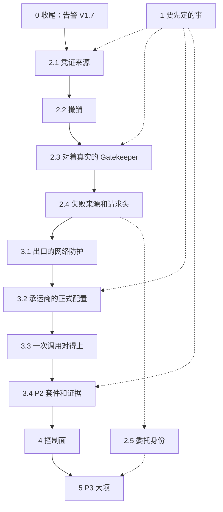

# 开发计划 — 出站网关，到真实第三方沙箱为止

> **状态**：草案 · **日期** 2026-11-17  
> 范围和先后是仓库所有者在 2026-11-17 定的，执笔的是 AI 编码助手。这不是具名批准：它不改变任何验收用例、缺口或门禁的 `NOT_RUN`，也不改变哪一篇 ADR 的 Proposed。

## 这份计划管什么

- **只排出站网关。** 到交付阶段 P2（真实第三方沙箱）为止拆成工作包，P3（生产候选）只列大项。Ingress 网关、AI 网关和管理后台不排，见第 6 节。
- **先请求路径，后控制面。** [G06](G06_Testing_and_Acceptance.md) 11.1 节规定的验收顺序里，身份和凭证排在发布之前；P2 要的几样（真实的凭证来源、撤销、出口防护）也都不在控制面上。
- **不写日期，不写负责人。** 项目清单里的负责人还是占位（[governance/README.md](governance/README.md)），这里不替谁填。
- **"P0、P1、P2"在仓库里有两个意思。** 本文说"阶段"的，是 [G01](G01_Requirements.md) 第 4 节的交付阶段（P0 设计与核验，P1 最小 PoC，P2 真实第三方沙箱，P3 生产候选）；说"优先级"的，是[缺口清单](governance/gap-remediation-matrix.csv)里的那一列。

## 现在在哪

- 阶段 P1 的内容跑过了：黑盒套件在锁定的 agentgateway 1.7.0 上 58/59，令牌是套件自己签的，Provider 是替身（[报告](../tests/acceptance/blackbox/README.md)）；另有与本机起的一套真实 Gatekeeper 的联调，Provider 同样是替身（[报告](../tests/integration/gatekeeper/README.md)）。两者都不是验收证据。
- 请求路径：`cmd/gateway-authz` 按请求判定并发放凭证。登记表和凭证来自文件，撤销状态在内存里，这三样都是占位（[ADR-0009](adr/ADR-0009.md)）。
- 控制面：`cmd/gateway-control` 管单机上的一个池：发布、对账、启动的先后、看守和告警用的指标（[ADR-0010](adr/ADR-0010.md)）。
- 正式的记录：95 条验收用例、15 项缺口、六个门禁全部是 `NOT_RUN`。

## 先后一览

实线是先后，虚线是依赖。第 4 节里不依赖别人的项，可以在等外部答复的空档里提前做。

## 每个工作包怎么做

- 动手之前先由仓库所有者点头。碰到还没有定的决定，先出一份 ADR 提案（新的一篇，或者现有某篇的新版本），点头之后才写代码。之前每一轮都是这样做的。
- 做完的标准写在各工作包里。集成用例照 `tests/integration/compose` 的做法：连跑三轮，再做对照（把做法改坏几处，看有没有用例不通过）。期望不放宽；用例因为环境不通过时修环境，不改用例。
- 改了 `cmd/` 或 `internal/` 下的非测试 Go 文件，就从干净的工作区重跑黑盒套件，证据单独提交；每一次都记在[黑盒报告](../tests/acceptance/blackbox/README.md)的"期望是怎么定的"里。
- 工作包做完，不等于对应的缺口或验收用例离开 `NOT_RUN`：那要真实执行、仓库里的证据和具名批准。

## 0. 收尾

- **告警（ADR-0010 V1.7）。** compose 套件要在时钟正常的机器上重跑一遍，这一轮才算收尾。2026-11-17 开发用的那台 WSL 内核时钟被调慢了，套件里一项拿两个时钟比的检查因此没有按原样通过。

## 1. 要先定的事

这些不是开发，但卡着 P2，而且多数要等别人，所以排在最前。

### 1.1 承运商的沙箱

- 选哪一家。它用哪种认证（OAuth2 客户端凭证、API Key、签名、mTLS），决定 2.6 里的几项做不做。
- 要两个独立的沙箱账户，并且有使用这个沙箱的合同授权（[G06](G06_Testing_and_Acceptance.md) 第 4、5 节）。
- 等：仓库所有者。

### 1.2 P2 用哪个 Gatekeeper

- 已发布的 `gk.idp.xyz` 是生产环境，任何测试都不访问它。P2 的调用方令牌要由一个非生产的 Gatekeeper 签发：联调用的本机实例，或者一个测试环境的实例。
- 等：仓库所有者和 Gatekeeper 团队。

### 1.3 Gatekeeper 一侧还没有定的五项

出处是[联调报告](../tests/integration/gatekeeper/README.md)的"需要 Gatekeeper 一侧决定的"。网关一侧的建议写在那里，没有与 Gatekeeper 的负责人确认过。

1. 授权模型里要不要有 Provider 账户这个类型。现在它只加在联调用的本机实例里；没有它，`gateway-authz` 向别的 Gatekeeper 问账户授权只会得到"没有结论"。
2. 出站网关的专属受众，以及 M2M 客户端怎么登记它。
3. 令牌里带不带环境。
4. `gateway-authz` 到 PDP 走不走 mTLS。现在是一个共享的 Bearer 令牌。
5. 访问令牌的签名密钥怎么换。

等：Gatekeeper 团队。

### 1.4 凭证由谁去取，撤销记在哪里

- 基线设计把凭证的登记和 Broker 放在 Gatekeeper（[G02](G02_Architecture.md) 11.1 节，[G04](G04_Identity_and_Security.md) 第 2 节）。现在的代码里发放凭证的是本仓库的 `gateway-authz`；[ADR-0009](adr/ADR-0009.md) 把"凭证从哪里来、撤销从哪里来"和"契约的归属要跟着改"列在没有定的里面。
- 2.1 和 2.2 各出一份 ADR 提案来回答。本计划按"`gateway-authz` 自己向 Provider 的令牌端点取令牌"排，理由写在 2.1；提案没有被接受，2.1 的内容就要改。
- 等：仓库所有者；涉及 Gatekeeper 职责的部分还要 Gatekeeper 团队。

### 1.5 测试主机

- P2 要连真实的第三方，令牌有有效期，证据里要记时钟（[G06](G06_Testing_and_Acceptance.md) 第 4 节）。主机要满足三样：不存在的名字解析不出来；时钟正常；到承运商沙箱的出口是确定的一条路。
- 2026-11-17 开发用的那台 WSL 前两样各出过一次问题：代理的 fake-IP DNS，和被调慢的内核时钟，各让一条用例不通过。修那一台，或者换一台。
- 等：仓库所有者。

### 1.6 跑出来的结果算什么

- [G06](G06_Testing_and_Acceptance.md) 第 6 节：进入 D2（Provider Sandbox）的条件是 D1（功能 PoC）通过，而 D1 现在是 `NOT_RUN`。黑盒套件的对端是替身，不算门禁证据（[governance/README.md](governance/README.md)）。
- 所以要定：P2 这一轮的结果算开发中的验证，还是算验收证据；算后者，由谁执行、谁批准。定下来之前，本计划里的运行都只算前者。
- [ADR-0008](adr/ADR-0008.md)（凭证经 ExtAuthZ 响应头注入）和 ADR-0010 仍是 Proposed：照它们做下去，是在没有批准的决定上继续投入。
- 等：仓库所有者，以及还没有指定的各位负责人。

## 2. 请求路径（`gateway-authz`）

判定对外部的三个要求写在 `internal/egressauthz/ports/ports.go`：凭证来源、撤销状态、账户授权。前两个现在的实现是占位（文件、内存）；第三个有一个默认不启用的 Gatekeeper 适配器。

### 2.1 凭证来源：OAuth2 客户端凭证

- **做什么**：给凭证来源加一个实现：用账户登记的客户端凭证向 Provider 的令牌端点取访问令牌。令牌按账户隔离着缓存，过期之前换新，同一个账户并发的请求只向令牌端点发一次；取不到、过期或答得不对就拒绝，不拿旧令牌顶替。客户端密钥从哪里读（文件，还是某个 Secret Manager），在 ADR 提案里定。
- **为什么排第一，为什么放在本仓库**：P2 要覆盖凭证的刷新和轮换，一份写着固定令牌的文件做不到。Gatekeeper 的模型里现在还没有 Provider 账户这个类型，凭证的登记和 Broker 在它那边还是提案（[变更清单](integrations/Fabric_and_Gatekeeper_Change_Impact.md)）。端口已经把这件事隔开：以后改由 Gatekeeper 的 Broker 提供时，换的是适配器。先对着替身令牌端点做，不等承运商选定。
- **依据**：`GW-GAP-02`；`GW-FR-006`、`GW-FR-018`、`GW-FR-033`；[G04](G04_Identity_and_Security.md) 第 4、11 节。
- **等**：1.4 的提案被接受。
- **做完的标准**：对着替身令牌端点，两个账户各拿各的令牌，不串用；令牌过期之后自动换新，并发时只取一次；令牌端点不可达、超时或答错时请求被拒绝，Provider 收不到请求；客户端密钥换了之后，新令牌是用新密钥取的；被撤销的账户拿不到缓存里的令牌；日志和任何应答里都没有客户端密钥和令牌。黑盒套件原有用例的结果不变。

### 2.2 撤销

- **做什么**：撤销状态能保存下来，`gateway-authz` 重启之后还在；产品构建里有一个写入它的入口，只有指定的身份能写。现在只有验收构建改得了它（黑盒套件用的控制接口）。入口是什么样、状态存在哪里，在 ADR 提案里定。
- **依据**：`GW-FR-026`、`GW-FR-047`；[G04](G04_Identity_and_Security.md) 第 11 节；ADR-0010 第 9 条（撤销由请求路径上的 `gateway-authz` 判定，封 Operation 待建）和它"成本与剩余风险"里"紧急变更这条路大半还没有建"一条。
- **等**：1.4 的提案被接受。启用 Gatekeeper 的账户授权时，在 Gatekeeper 里收回授权是另一条已经通的路（联调的 `GK-07`），它依赖 1.3 的第 1 项。
- **做完的标准**：撤销一个账户之后，下一个请求即被拒绝，另一个账户不受影响（黑盒的 `P1-RV-01` 在产品构建的入口上成立）；重启 `gateway-authz` 之后撤销仍然有效；没有被授权的身份写不进去；撤销状态读不到时不放行。按 Operation 封禁做不做、多个实例之间怎么传播，在提案里写明；不做的列进第 5 节。

### 2.3 对着真实的 Gatekeeper

- **做什么**：让请求路径在一个真实的、非生产的 Gatekeeper 签发的令牌上成立，并把 1.3 定下来的各项做进来：令牌的形状（主体和租户都是 UUID、受众、有没有环境声明），`gateway-authz` 到 PDP 的 mTLS。P2 用的 JWKS 按 ADR-0010 第 8 条以文件随配置下发，这一轮手工放进去；自动同步在第 4 节。
- **依据**：`GW-FR-003`、`GW-FR-004`、`GW-FR-021`、`GW-FR-028`；联调报告"联调中看清的事"第 1 到 4 点。
- **等**：1.2 和 1.3。Gatekeeper 没有定的项，联调保持报告里现在的做法，不替它决定。
- **做完的标准**：联调套件按定下来的做法全部通过；凡是 Gatekeeper 已经接受的项，不再靠只加在本机实例里的改动；`gateway-authz` 到 PDP 出示客户端证书，没有证书的连接问不到结果。

### 2.4 黑盒报告里两条"未解决"

- **做什么**：
  - 失败来源：`gateway-authz` 不可达或超时的时候，调用方现在得到 403，和策略拒绝一样。在锁定的版本上试出，网关能不能让这两种情况给出不同的应答。
  - 请求头：现在是按名字删，调用方自己加的头仍会到达 Provider。试出能不能改成只放行登记过的头，在网关上做，或者在前置代理上做。
- **依据**：`GW-GAP-11`、`GW-FR-043`；`GW-FR-008`，[G03](G03_Routing_and_Configuration.md) 第 5 节。[ADR-0008](adr/ADR-0008.md) 写明这两条在批准之前要处置或接受。
- **等**：不等别人。
- **做完的标准**：每一条要么有处理，并且有黑盒用例把关；要么写明在锁定的版本上做不到、留下什么风险，交给批准人去接受。

### 2.5 委托身份

- **做什么**：用户委托的身份参与判定。现在决策请求里的 `delegated_subject` 按契约接受，不参与判定。
- **依据**：`GW-GAP-03`、`GW-FR-032`；[G04](G04_Identity_and_Security.md) 11.1 节。
- **等**：Gatekeeper 的用户令牌流程。联调没有覆盖它。
- **为什么排在这条线最后**：缺口清单把它列在优先级最高的一档，但 G01 对 P2 的要求（两个租户或账号、两个调用身份、凭证的刷新和轮换、结果未知、无权限、撤销传播）用不到它，而它要等 Gatekeeper。它要在 P3 之前做完。
- **做完的标准**：`GW-FR-032` 的观察点成立：伪造的用户头、账户头和对不上的委托链全部被拒绝。细节随提案写。

### 2.6 视承运商而定

选定的承运商用到哪一样，才做哪一样；都用不到的留到第 5 节。

- API Key。现在端口和评审过的配置都只认 `Authorization` 这一个头。放在别的请求头里时要把这一处放开；放在请求头以外（比如查询参数）时，复制响应头做不到，按 [ADR-0008](adr/ADR-0008.md) 第 4 条单独评估并补测。
- 签名（HMAC 或承运商私有的）。要对最终外发的方法、路径和正文签名；[G04](G04_Identity_and_Security.md) 第 4 节建议用一个受限的签名适配器。
- 对 Provider 的 mTLS。

## 3. 进沙箱

### 3.1 出口的网络防护

- **做什么**：黑盒套件没有覆盖的两样。一，上游的名字后来解析到了别的地址（内网、回环、IPv6）会怎样：先在隔离的网络里对着替身解析器，测出锁定版本的行为。二，网关所在的容器除了登记的上游还连得到哪里：在单机上把这个池的出口限制到登记的地址，用什么做到时定。
- **依据**：`GW-GAP-04`；`GW-FR-005`、`GW-FR-023`、`GW-FR-034`。[G06](G06_Testing_and_Acceptance.md) 第 3 节把"出站网络"列为挡住 P2 的一项。
- **等**：1.5，主机的 DNS 得是真的。
- **做完的标准**：名字改解析到没有登记的地址时，请求到不了那里；从网关的容器连没有登记的地址连不通；重定向、指定上游、路径变形这些现有用例的结果不变。攻击性的测试只对着替身做，不发给真实的第三方。

### 3.2 承运商的正式出站配置

- **做什么**：为选定的承运商手写一份 agentgateway 配置和一份登记表：一个创建操作（比如建单），一个查询操作。调用方令牌按 P2 的 Gatekeeper 验证；到 `gateway-authz` 是 mTLS；到承运商是 TLS，核对证书和 SNI（黑盒套件里这一段是明文）；黑盒报告"默认配置不安全的地方"的八项逐项处理。经 `gateway-control publish` 发布到 [deploy/compose](../deploy/compose/README.md) 描述的那个池上。这一轮不做编译器：配置是手写、评审过的。
- **依据**：`GW-GAP-01`；`GW-FR-002`、`GW-FR-023`、`GW-FR-039`；[deploy/agentgateway/README.md](../deploy/agentgateway/README.md)。
- **等**：1.1。
- **做完的标准**：这份配置通过发布器的离线加载和回读确认；八项处理在这份配置上逐项有用例检查，对着替身跑通之后才连沙箱；快照里没有密钥，也没有对环境变量的引用（ADR-0010 第 11 条）。

### 3.3 一次调用对得上

- **做什么**：一次调用能从调用方的请求对到 `gateway-authz` 的判定（它已经给每次判定一个编号），再对到承运商返回的请求编号。先确认锁定版本的访问日志带得上哪些字段，缺的在 `gateway-authz` 的日志里补。只做 P2 的证据用得上的最小一组；完整的 Trace 和审计在第 5 节。
- **依据**：`GW-FR-017`；[G05](G05_Engineering_and_Operations.md) 11.2 节列的关联字段；[G06](G06_Testing_and_Acceptance.md) 第 1 节 V3 的证据要求。
- **等**：不等别人。
- **做完的标准**：拿一次沙箱调用的编号，能在网关和 `gateway-authz` 的日志里找到同一次调用的两头，以及承运商的请求编号；这些日志里没有令牌和密钥。

### 3.4 P2 套件和证据

- **做什么**：一套对着承运商沙箱的用例：两个租户、两个沙箱账户、两个调用身份，创建和查询；凭证的刷新和轮换；写操作超时或断连时结果记为未知，不重放；没有授权的调用被拒绝；撤销之后被拒绝。证据按 [G06](G06_Testing_and_Acceptance.md) 第 4 节记全：镜像摘要、Gatekeeper 的提交、本仓库的提交、登记表的摘要、环境、时钟、数据集、执行人。沙箱的凭证不进仓库，也不进证据和日志。
- **依据**：G01 第 4 节对 P2 的要求；[G04](G04_Identity_and_Security.md) 第 9 节；`GW-FR-006`、`GW-FR-012`、`GW-FR-026`、`GW-FR-043`。
- **等**：第 1 节的全部，2.1 到 2.4，3.1 到 3.3。
- **做完的标准**：用例在沙箱上通过，证据入库。对承运商只发它的合同允许的正常请求，不做压测和攻击性测试（[G06](G06_Testing_and_Acceptance.md) 第 5 节）。结果算不算验收证据，按 1.6 定下来的办。

## 4. 控制面（排在后面）

内容是 [ADR-0010](adr/ADR-0010.md) 各版末尾的"还没有做的"。

1. **真机验证。** 真的重启一台机器；把两个 systemd 单元装上去跑。要一台能装系统级单元的机器。
2. **发布历史和发布状态。** 现在只记最后一条确认过的快照。要做的是保存快照、记录发布过什么，以及 [G03](G03_Routing_and_Configuration.md) 第 3 节的状态机和审批。持久化要先定：[ADR-0009](adr/ADR-0009.md) 第 4 条规定控制面的持久化用 Bento-Go，第一次引入时同时带上 `tests/bentocontract` 和显式的迁移命令，版本到时再确认。`GW-GAP-06`。
3. **RouteIntent 编译器。** 把中立的意图编译成 agentgateway 配置，用锁定的二进制校验；`scripts/preflight_intents.py` 的预检移植成 Go；`gateway-authz` 的登记表改由控制面下发。`GW-GAP-06`；`GW-FR-039`、`GW-FR-048`。
4. **换镜像、JWKS、发布器的证书。** 换镜像（升级）这个操作；JWKS 的同步；发布器证书的签发和轮换。`GW-GAP-13`、`GW-FR-045`。
5. **别的平台和规模。** Kubernetes 上的下发；一台机器上放不止一个池；日志和资源上限。
6. **告警送到谁。** 规则在仓库里，路由和接收人不在。

## 5. P3 生产候选（只列大项）

- 流量治理：账户级的配额和限流、连接上限、熔断、超时预算。`GW-GAP-05`、`GW-GAP-09`。
- 协议兼容矩阵的 12 项：gRPC、流式、大报文等。`GW-GAP-10`。
- 报文采集与脱敏：`scripts/diagnostic_reference.py` 的移植，四阶段的证据。`GW-GAP-07`。
- 完整的 Trace 和审计，SLO。`GW-FR-017`、`GW-GAP-08`。
- 多实例：单机是单点（ADR-0010 的"成本与剩余风险"），压测和 11 项故障演练要多实例的部署。
- 安全测试；镜像的签名和 SBOM。`GW-GAP-13`。
- 第 2 节留下来的：按 Operation 封禁、撤销在多个实例之间的传播、没有用到的认证方式。
- 运行交接和具名批准：六个门禁，各篇 ADR。

## 6. 没有排的

- **Ingress 网关和 AI 网关。** G01 的范围里有；仓库里只有 RouteIntent 的示例。
- **管理后台。** 范围冻结（[governance/README.md](governance/README.md)），解冻的条件之一是 ADR-0008 获具名批准。
- **与 API Fabric 的发布对接。** 只有契约（`contracts/fabric/`）；要等第 4 节的编译器，和 Fabric 一侧。

## 缺口清单对到哪里

| 缺口 | 在本计划里的位置 |
|---|---|
| `GW-GAP-01` 真实数据面集成 | 3.2 |
| `GW-GAP-02` 多租户动态凭证 | 2.1，2.6 |
| `GW-GAP-03` 委托身份与服务身份绑定 | 2.5 |
| `GW-GAP-04` 出口网络 SSRF 安全 | 3.1 |
| `GW-GAP-05` 连接/熔断/过载保护 | 第 5 节 |
| `GW-GAP-06` 配置编译与渐进发布 | 第 4 节 |
| `GW-GAP-07` 真实报文采集与脱敏 | 第 5 节 |
| `GW-GAP-08` 运行 SLO 与生产验收 | 第 5 节 |
| `GW-GAP-09` ProviderAccount 额度与限流 | 第 5 节 |
| `GW-GAP-10` HTTP/gRPC 兼容矩阵 | 第 5 节 |
| `GW-GAP-11` 故障来源与跨系统诊断 | 2.4 和 3.3；其余在第 5 节 |
| `GW-GAP-12` 管理后台真实授权与审计 | 第 6 节 |
| `GW-GAP-13` 版本升级与供应链保护 | 第 4 节（换镜像），第 5 节（签名、SBOM） |
| `GW-GAP-14` 沙箱 API Try / 契约检查 | 没有排：SHOULD，跟着管理后台和诊断走 |
| `GW-GAP-15` 智能故障辅助判断（建议而非自动执行） | 没有排：SHOULD，跟着管理后台和诊断走 |

## 怎么改这份计划

第 1 节的事定下来一件，就改对应的工作包。一个工作包做完，在它下面写上做到了什么、哪一篇 ADR 的哪一版、哪个提交；没有做到的照实写。范围或先后要变，由仓库所有者定，改在"这份计划管什么"里。
