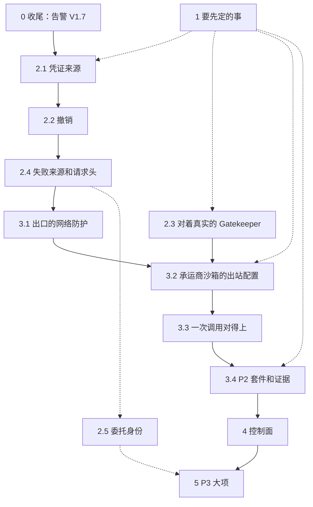

# 开发计划 — 出站网关，到真实第三方沙箱为止

> **状态**：草案 · **日期** 2026-11-17  
> 范围和先后是仓库所有者在 2026-11-17 定的，执笔的是 AI 编码助手。这份计划本身不改变任何验收用例、缺口或门禁的 `NOT_RUN`。2026-11-21 仓库所有者把 ADR-0001 至 ADR-0008 定为 Accepted，同日已把 ADR-0010 至 ADR-0017 定为 Accepted；那不是这份计划改的。2026-11-19 仓库所有者定：项目不用角色分离和具名批准，由仓库所有者决定，验证看证据（[governance/README.md](governance/README.md)）。

## 这份计划管什么

- **只排出站网关。** 到交付阶段 P2（真实第三方沙箱）为止拆成工作包，P3（生产候选）只列大项。Ingress 网关、AI 网关和管理后台不排，见第 6 节。
- **先请求路径，后控制面。** [G06](G06_Testing_and_Acceptance.md) 11.1 节规定的验收顺序里，身份和凭证排在发布之前；P2 要的几样（真实的凭证来源、撤销、出口防护）也都不在控制面上。
- **不写日期，不写负责人。** 项目清单里的负责人还是占位（[governance/README.md](governance/README.md)），这里不替谁填。
- **"P0、P1、P2"在仓库里有两个意思。** 本文说"阶段"的，是 [G01](G01_Requirements.md) 第 4 节的交付阶段（P0 设计与核验，P1 最小 PoC，P2 真实第三方沙箱，P3 生产候选）；说"优先级"的，是[缺口清单](governance/gap-remediation-matrix.csv)里的那一列。

## 现在在哪

- 阶段 P1 的内容跑过了：黑盒套件在锁定的 agentgateway 1.7.0 上 96/97，令牌是套件自己签的，Provider 是替身（[报告](../tests/acceptance/blackbox/README.md)）；另有与本机起的一套真实 Gatekeeper 的联调，Provider 同样是替身（[报告](../tests/integration/gatekeeper/README.md)）。两者都不是验收证据。
- 请求路径：`cmd/gateway-authz` 按请求判定并发放凭证。登记表和凭证来自文件，是占位（[ADR-0009](adr/ADR-0009.md)）；撤销表原先只在内存里，2026-11-18 起落在一个文件里，由一个工作负载身份经接口改（[ADR-0012](adr/ADR-0012.md)）。凭证从哪里来的提案是 [ADR-0011](adr/ADR-0011.md)；仓库所有者在 2026-11-18 同意照它动手。2026-11-21 仓库所有者把这篇定为 Accepted。它的第一步（固定令牌加每个请求一个随机数）已经有了实现，只对着替身验证过。黑盒的评审配置只放行登记过的请求头；问不到 PDP 时调用方得到 503，策略拒绝仍是 403（2.4）。
- 控制面：`cmd/gateway-control` 管单机上的一个池：发布、对账、启动的先后、看守和告警用的指标（[ADR-0010](adr/ADR-0010.md)）。2026-11-20 又有 `sync-jwks` 和 `compile`（4.4、4.3）。
- 正式的记录：95 条验收用例、15 项缺口、六个门禁全部是 `NOT_RUN`。
- **先后的调整（2026-11-19，仓库所有者定）**：先走到真实的承运商。接下来依次是 2.3（只做到 PDP 的 mTLS）和 3.2；控制面其余各项、已有功能的细处，留到 P2 之后或者上线之后再迭代。原因：最大的几个未知数（真实承运商怎么回应、真机上的部署、Gatekeeper 团队的确认）一个都还没有碰过，而单机池这一侧已经做得比它们细得多。这是当天调整先后时的理由。万邦的沙箱后来在 3.2 连过；顺丰国际的配置在 2026-11-20 经网关对着真实沙箱跑过（1.1）。同日做了面单（1.1、2.6）、JWKS 同步（4.4）、出站编译（4.3）和一部分流量治理（第 5 节）。对应的 ADR 在 2026-11-21 由仓库所有者定为 Accepted。真的重启一台机器，和 Gatekeeper 团队的确认，仍没有碰过。

## 先后一览

实线是先后，虚线是依赖。第 4 节里不依赖别人的项，可以在等外部答复的空档里提前做。

## 每个工作包怎么做

- 动手之前先由仓库所有者点头。碰到还没有定的决定，先出一份 ADR 提案（新的一篇，或者现有某篇的新版本），点头之后才写代码。之前每一轮都是这样做的。
- 做完的标准写在各工作包里。集成用例照 `tests/integration/compose` 的做法：连跑三轮，再做对照（把做法改坏几处，看有没有用例不通过）。期望不放宽；用例因为环境不通过时修环境，不改用例。
- 改了 `cmd/` 或 `internal/` 下的非测试 Go 文件，就从干净的工作区重跑黑盒套件，证据单独提交；每一次都记在[黑盒报告](../tests/acceptance/blackbox/README.md)的"期望是怎么定的"里。
- 工作包做完，不等于对应的缺口或验收用例离开 `NOT_RUN`：那要真实执行，和仓库里的证据，由仓库所有者决定。

## 0. 收尾

- **告警（ADR-0010 V1.7）已经收尾。** 2026-11-17 这台 WSL 的时钟对准之后，compose 套件连跑三轮，都是 21/21，每轮 669 到 686 秒。`GatewayKeeperDown` 从看守停下算起是 61.1、61.1、61.0 秒，落在原来的 60 到 75 秒里；检查没有放宽。更早量到的 54 到 56 秒是单调时钟被调慢了。`units.py` 是 6/6。黑盒证据已按这次的源码重跑：58/59，失败的仍是 `P1-SS-04`，326 项检查与上一份逐项相同。`SH-20` 和 `SH-21` 没有做对照。这不是具名批准，验收状态仍是 `NOT_RUN`。ADR-0010 在 2026-11-21 由仓库所有者定为 Accepted。

## 1. 要先定的事

这些不是开发，但卡着 P2，而且多数要等别人，所以排在最前。

### 1.1 承运商和它的沙箱

- **2026-11-17 定了：万邦速达（WanbExpress）的沙箱。** [对接文档](http://apidoc.wanbexpress.com/)是公开的；沙箱的地址和一个测试账号是仓库所有者给的。按文档，对接在沙箱里做完、把单号交给对方核对之后，对方才给正式环境的地址和令牌。
- **2026-11-17 只读地确认过沙箱是通的。** 验证授权的接口认这个测试账号；它名下有 18 个测试产品（包括文档示例用的那一个）和 7 个仓库。沙箱只有明文 HTTP。
- **认证是一个固定的开发者令牌**，放在 `Authorization` 里，格式是 `Hc-OweDeveloper 账号;令牌;随机数`，随机数每个请求换一个。账号就在凭证里，所以网关"按账户选凭证"的隔离对它合用。它不是 OAuth2，见 2.1。
- **用得上的操作**：创建包裹 `POST /api/parcels`；按处理号查 `GET /api/parcels/{processCode}`；按客单号搜 `GET /api/parcels?referenceId=`；删除 `DELETE /api/parcels/{processCode}`；验证授权 `GET /api/whoami`。
- **创建有文档写明的防重。** 客单号全局唯一，重复时返回错误码 `0x100005`；超时之后用同一个客单号再下，或者按客单号把上一次的结果搜回来。
  - 沙箱实际的行为（2026-11-19 量的，与文档和上面不同）：同一个客单号、正文完全相同再创建，答 `Succeeded` 真和已有的处理号，不新建；正文不同才是 `0x100005`；删除之后客单号可再用；查不到的处理号是 HTTP 404、正文为空；同一个随机数用两次、`Accept` 不是 `application/json`，沙箱都不拒。
- **只有一个测试账号。** P2 要两个账户（[G06](G06_Testing_and_Acceptance.md) 第 4 节）：要么向对方再要一个，要么两个账户之间的隔离只在替身上验。等：仓库所有者定。 **2026-11-19 定了**：第二个账号要不到，两个账户之间的隔离只在替身上验；沙箱上验的是"没有登记账户的租户被拒"。
- 先前看过的另一家（嘉谷万邑的 Dragon Open API）用的是 OAuth2 客户端凭证，文档里也有沙箱。它留作 2.1 第二步以后对着真实系统验证的候选。那一家给的账号在正式环境上，下单出的是真实面单，不用来测试。
- **2026-11-20 选定第二家承运商：顺丰国际（出口电商 IECS）**（仓库所有者定）。[对接文档](https://openapi-portal.sf.global/)是公开的；沙箱 `http://api-ifsp-sit.sf.global` 只有明文 HTTP；沙箱的凭证是文档"测试环境授权信息"一页公开给出的一套，所有人共用，不进仓库。它的协议要加密请求正文、对密文签名，装不进现在"复制一个 `Authorization` 头"的做法；提案是 [ADR-0014](adr/ADR-0014.md)（2026-11-21 定为 Accepted）。
  - 同日只读探测过沙箱（三个请求，都是文档写明的正常用法，没有创建订单；从开发机直连，不经代理）：取令牌两次，都是 `apiResultCode` 0、`expireIn` 7200，两次是同一个令牌（与文档常见问题"测试环境令牌固定"一致）；用 `IECS_QUERY_AGENTNO` 查一个不存在的订单号，`apiResultData` 解得开，是业务 JSON，`wrongData` 里一条 `status` 为 `4001`（未找到）。所以加密、签名、解密的算法在沙箱上是对的；沙箱上验不了令牌 2 小时过期、取了新的旧的失效，和到承运商的 TLS。探测用的程序和凭证在仓库之外，没有入库。
  - 同日在写替身之前，用仓库之外的一个临时程序量过沙箱（一个客单号、两张运单，都取消了，没有剩下的）：每次应答都是 HTTP 200、`application/json`；成功的信封恰好是 `apiResultCode`、`apiResultData`、`apiTimestamp`，没有 `apiErrorMsg`；创建约 1.1 秒，`success` 真，有 `sfWaybillNo`，没有业务 `code`；同一份正文再创建，`success` 真、`code` 为 `"123052"`、运单号不变；刚创建的单查代理单号是 `wrongData` 的 `status` `"4002"`（代理单号未生成），不存在或已取消的是 `"4001"`；创建之后 1.2 秒和约 3.6 秒的两次取消答 `code` `"500"`、`success` 假，订单还在，稍后再取消成功；取消之后客单号可以再用。没有量的：同一个客单号换一份正文、取消不存在的订单、信封一级的拒绝。替身把文档、量到的、更严的地方和假设分开写在 `tests/integration/sfintl/mock_sfintl.py` 开头。
  - 同日这份配置经网关、`gateway-authz` 和 `provider-signer` 对着真实沙箱跑过，在联调架子上（[套件](../tests/integration/sfintl/README.md)）。第二遍 14/14（233 项检查：168 过、65 跳过、0 失败，17.7 秒）。当时写入的 [rig-sandbox.json](../tests/integration/sfintl/evidence/rig-sandbox.json) 后来被提交 `e1b01ed` 覆盖，见本条面单那一项。第一遍 13/14：前两次取令牌失败，证据没有留在仓库里，写在提交 `7fd2dd2` 的说明里。单机池是当天的第三步，见下一条。
  - 同日进了单机池（[ADR-0014](adr/ADR-0014.md) V1.2，[套件](../tests/integration/sfintl/README.md)的「单机池上」）。对着替身：当时写入 [pool-standin.json](../tests/integration/sfintl/evidence/pool-standin.json)（后来被提交 `e1b01ed` 覆盖），在 `1a144d0` 上、未提交文件数 0，15 个用例、0 个失败、2 个跳过（SF-09、SF-12），266 项检查里 264 项过、2 项跳过，97 秒，创建并取消了 9 张单，没有剩下的。对着沙箱：提交 `1a144d0` 写 `--sandbox` 在那个提交里没有跑；随后在同一提交上跑了两遍，SF-01 和 SF-02 都没过（取消的业务 `code` 是 `"500"`，套件当时只试 6 次、每次隔 3 秒；有一遍 SF-01 的第一次查询是 HTTP 503），证据没有留，订单后来手工取消了（提交 `91aa333` 的说明；有一张单手工重试了大约两分钟）。预算改成 300 秒之后试了一遍，当时还没有改成 600 秒（提交 `149aa0e` 的说明）：SF-01 过了（取消在第二次被接受），SF-02 的取消被拒 28 次、295.9 秒，用例没过，那张单后来手工取消了。预算 600 秒的那一遍在干净的 `7ec6f20` 上跑过，未提交文件数 0，当时写入 [pool-sandbox.json](../tests/integration/sfintl/evidence/pool-sandbox.json)（提交 `710acb1`，后来被 `e1b01ed` 覆盖）：从 2026-11-20T10:12:38Z 到 10:23:02Z，15 个用例、0 个失败，SF-03、SF-09、SF-12、SF-13、SF-14 按设计跳过，217 项检查里 157 项过、60 项跳过、0 项失败。SF-01 的取消是 44 次、493.595 秒，第 44 次被接受；SF-02 是 2 次、6.455 秒。两张单都取消了，没有剩下的。第一次查询是 HTTP 200，没有见到取令牌失败，`cause` 在沙箱上仍没有见到。SF-10 和 SF-11（10 项）过了。2026-11-20 在沙箱上量到的取消：要么下单后几秒内被接受（上午的手工量、联调架子上的两遍、300 秒试跑里 SF-01 是 2 次、6.1 秒，以及这一遍的 SF-02 是 2 次、6.455 秒），要么要到下单之后大约 5 到 8.5 分钟（两张单大约 4 分 45 秒和 5 分钟；一张被拒了 295.9 秒，又过大约 2.5 分钟，下一次才接受；这一遍的 SF-01 从第一次取消尝试起 493.595 秒，约 8.2 分钟）。600 秒的预算这一次够用，还剩 106 秒。不是说以后都够。拒绝是承运商的业务应答：HTTP 200、`apiResultCode` 0、`code` `"500"`、`msg` `"请求服务发生异常"`、`success` 假。原因不知道。量的是沙箱，不是生产。
  - 同日加了面单 `IECS_PRINT_ORDER`（提交 `95e2b90`，[ADR-0014](adr/ADR-0014.md) V1.3）。操作是 `labels.print`。调用方 `POST /providers/sfintl/v1/label-prints`，签名器 `POST /sfintl/v1/label-prints`。写代码之前在仓库之外对沙箱量过一次：未取消的订单交回 OSS 上的 PDF URL，取这个 URL 不需要鉴权头（HTTP 206、`application/pdf`，开头是 `%PDF-`）；已取消的订单，`customerOrderNo` 末尾是 `_cancel`。网关只交回解开的 JSON，不代理 OSS。对着替身：联调架子 14/14（327 项检查，0 失败，0 跳过），池上 15/15（307 项通过，2 项跳过）。这两遍没有叫真实承运商。对照 `--mutate bearer-prefix` 是 5/14，`--control no-signer-name` 是 7/15。四条路由的证据在提交 `e1b01ed`（跑在干净的 `4416f89`）：替身联调 14 个用例、327 项都过；替身池 15 个用例、309 项里 307 过、2 跳过；沙箱联调 14 个用例、275 项里 200 过、75 跳过；沙箱池 15 个用例、259 项里 189 过、70 跳过；没有剩下未取消的订单。逐项在 [tests/integration/sfintl/README.md](../tests/integration/sfintl/README.md) 的「四条路由」和 [ADR-0014](adr/ADR-0014.md) V1.3。

### 1.2 P2 用哪个 Gatekeeper

- 已发布的 `gk.idp.xyz` 是生产环境，任何测试都不访问它。P2 的调用方令牌要由一个非生产的 Gatekeeper 签发：联调用的本机实例，或者一个测试环境的实例。
- **2026-11-19 定了：用联调的本机实例。** 仓库所有者把这一项交给网关一侧定。它是现在唯一的非生产实例，从固定的提交构建，谁都能重现。P2 的证据里要写明：令牌出自一个带着本机改动的实例（见 1.3），不是 Gatekeeper 团队运行的环境，并记下 Gatekeeper 的提交号。出现共享的测试实例、并且 1.3 的各项进了 Gatekeeper 自己的代码时重看。

### 1.3 Gatekeeper 一侧还没有定的五项

出处是[联调报告](../tests/integration/gatekeeper/README.md)的"需要 Gatekeeper 一侧决定的"。网关一侧的建议写在那里，没有与 Gatekeeper 的负责人确认过。

1. 授权模型里要不要有 Provider 账户这个类型。现在它只加在联调用的本机实例里；没有它，`gateway-authz` 向别的 Gatekeeper 问账户授权只会得到"没有结论"。
2. 出站网关的专属受众，以及 M2M 客户端怎么登记它。
3. 令牌里带不带环境。
4. `gateway-authz` 到 PDP 走不走 mTLS。现在是一个共享的 Bearer 令牌。
5. 访问令牌的签名密钥怎么换。

**2026-11-19，仓库所有者把这五项交给网关一侧定。定的是网关按什么做、P2 在什么上面跑；这不是 Gatekeeper 团队的确认。**

1. Provider 账户类型：要，用联调试过的 `provider_account` 定义。
2. 受众：出站网关用专属受众 `idp-egress-gateway`，网关只认它。P2 沿用本机实例改全局开关的做法（粗：之后新建的每个 M2M 客户端都能申请它）。
3. 环境：P2 不带，按"一个签发者只属于一个环境"办，一个池只信一个签发者。带环境要改 Gatekeeper 的令牌钩子，本机实例不改它的代码做不到。
4. 到 PDP 走工作负载 mTLS，网关这边现在就做（2.3）：适配器出示客户端证书，本机栈在 PDP 前面加一个要求客户端证书的 TLS 终结；Bearer 令牌过渡期照带。
5. 换密钥：先发布、后启用，等待的时间长于"发现 JWKS 变了，再做一次发布"。P2 里手工放。

**上生产之前要 Gatekeeper 团队做的四件**（本仓库做不了，也不替它做）：第 1 项的类型进它自己的授权模型；第 2 项改成按客户端登记受众；第 3 项令牌里带环境；第 5 项把先发布后启用写成它的换钥流程。

### 1.4 凭证由谁去取，撤销记在哪里

- 基线设计把凭证的登记和 Broker 放在 Gatekeeper（[G02](G02_Architecture.md) 11.1 节，[G04](G04_Identity_and_Security.md) 第 2 节）。现在的代码里发放凭证的是本仓库的 `gateway-authz`；[ADR-0009](adr/ADR-0009.md) 把"凭证从哪里来、撤销从哪里来"和"契约的归属要跟着改"列在没有定的里面。
- 凭证从哪里来：[ADR-0011](adr/ADR-0011.md)。它按"凭证正文由 `gateway-authz` 自己持有"写。2026-11-18 仓库所有者同意照它做 2.1，那是开工的许可；2026-11-21 仓库所有者把这篇定为 Accepted。
- 撤销记在哪里：[ADR-0012](adr/ADR-0012.md)（2026-11-18 同意照它动手是开工的许可；2026-11-21 定为 Accepted）。它按"`gateway-authz` 自己落盘，写入口只认一个工作负载身份"写；Gatekeeper 里收回授权是另一层，不动。
- 2026-11-18 仓库所有者同意照 ADR-0012 做 2.2，和 ADR-0011 一样是开工的许可。等：涉及 Gatekeeper 职责的部分还要 Gatekeeper 团队。

### 1.5 测试主机

- P2 要连真实的第三方，令牌有有效期，证据里要记时钟（[G06](G06_Testing_and_Acceptance.md) 第 4 节）。主机要满足三样：不存在的名字解析不出来；时钟正常；到承运商沙箱的出口是确定的一条路。
- 2026-11-17 开发用的那台 WSL 三样都不满足。代理的 fake-IP DNS 和被调慢的内核时钟，各让一条用例不通过；外面的名字被解析成 fake-IP 之后，从它里面连不出去，对接文档和沙箱的地址是从 Windows 一侧读到的。
- 2026-11-18 在同一台上重看，三样里修好了两样，第三样有条件：
  - 时钟好了。Windows 的时间服务重新打开并换了时间源，与外部时间源相差 0.05 秒；WSL 里与它打架的 `systemd-timesyncd` 停用了。跑用例之前仍先看一眼时钟。
  - 不存在的名字解析不出来，本机和容器里都是。前提是 Windows 上代理的 TUN 关着；它一开，fake-IP 就回来。
  - 到沙箱有一条直连的路：不带凭证的请求，从本机不走代理、从一个没有代理设置的容器，都得到沙箱自己答的 403。但这台机器的 shell 里设着 `HTTP_PROXY`、`HTTPS_PROXY`，指向本机的代理端口；从 shell 起的进程只要认这些变量（Go 默认的 HTTP 客户端、curl、Python 都认），出去走的就是代理。沙箱用例要在去掉这些变量的环境里跑，并在证据里记下来。
- 这仍是一台开发机，上面三条里有两条靠的是别的软件此刻的开关。P2 用它还是换一台，等：仓库所有者。

### 1.6 跑出来的结果算什么

- [G06](G06_Testing_and_Acceptance.md) 第 6 节：进入 D2（Provider Sandbox）的条件是 D1（功能 PoC）通过，而 D1 现在是 `NOT_RUN`。黑盒套件的对端是替身，不算门禁证据（[governance/README.md](governance/README.md)）。
- 原来要定的是：P2 这一轮的结果算开发中的验证，还是算验收证据。下面定了。
- [ADR-0008](adr/ADR-0008.md)（凭证经 ExtAuthZ 响应头注入）在 2026-11-21 由仓库所有者定为 Accepted。ADR-0010 在 2026-11-21 由仓库所有者定为 Accepted。状态由仓库所有者决定（见下一条和 [governance/README.md](governance/README.md)）。
- **2026-11-19 定了（仓库所有者）**：这是一个技术软件，不用执行人和批准人分开的做法，那只会增加复杂度。P2 这一轮的结果照实记成验证的记录：跑了什么、在哪些提交和镜像上、看到了什么；不设批准人，不等门禁的结论。3.4 不再等这一项。

## 2. 请求路径（`gateway-authz`）

判定对外部的三个要求写在 `internal/egressauthz/ports/ports.go`：凭证来源、撤销状态、账户授权。凭证来自文件，是占位；撤销表落在一个文件里（2.2）；第三个有一个默认不启用的 Gatekeeper 适配器。

### 2.1 凭证来源

- **做什么**，分两步：
  - 第一步，1.1 那一家的凭证。它的认证头里有一个每个请求都要换的随机数，而现在的凭证来源给出的是一个固定的头。头的格式、文件和换令牌的做法写在 [ADR-0011](adr/ADR-0011.md)，这里不另写一份。P2 要的是这一步。
  - 第二步，OAuth2 客户端凭证。向 Provider 的令牌端点取访问令牌；令牌按账户隔离着缓存，过期之前换新，同一个账户并发的请求只向令牌端点发一次；取不到、过期或答得不对就拒绝，不拿旧令牌顶替。对着替身令牌端点做。1.1 的那一家用不到它，所以它不在 P2 的必经路上；[G04](G04_Identity_and_Security.md) 第 9 节要固定凭证和动态 OAuth 两种都证明，所以仍然要做。
- **为什么放在本仓库**：Gatekeeper 的模型里现在还没有 Provider 账户这个类型，凭证的登记和 Broker 在它那边还是提案（[变更清单](integrations/Fabric_and_Gatekeeper_Change_Impact.md)）。端口已经把这件事隔开：以后改由 Gatekeeper 的 Broker 提供时，换的是适配器。
- **依据**：`GW-GAP-02`；`GW-FR-006`、`GW-FR-018`、`GW-FR-033`；[G04](G04_Identity_and_Security.md) 第 4、11 节。
- **等**：不等别人。仓库所有者在 2026-11-18 同意照 [ADR-0011](adr/ADR-0011.md) 动手。
- **做完的标准**：
  - 第一步：发给上游的认证头格式对，每个请求的随机数都不同；令牌换了之后，新请求用的是新令牌；日志和任何应答里都没有令牌。
  - 第二步：对着替身令牌端点，两个账户各拿各的令牌，不串用；令牌过期之后自动换新，并发时只取一次；令牌端点不可达、超时或答错时请求被拒绝，Provider 收不到请求；客户端密钥换了之后，新令牌是用新密钥取的；被撤销的账户拿不到缓存里的令牌；日志和任何应答里都没有客户端密钥和令牌。
  - 两步都要：黑盒套件原有用例的结果不变。
- **到哪了（2026-11-18）**：第一步对着替身做完了，记在 [ADR-0011](adr/ADR-0011.md) 的 V1.1 一节。四条标准都在替身上看到了：Provider 收到的头格式对，随机数次次不同（[黑盒](../tests/acceptance/blackbox/README.md)的 `P1-DT-01`）；换掉令牌文件，下一个请求用的就是新令牌，`gateway-authz` 不重启（`P1-DT-04`）；网关和 `gateway-authz` 的日志、给调用方的应答里都没有账号和令牌（`P1-DT-01`、`P1-DT-05`）；原有 59 个用例的结果不变。还没有的：承运商的沙箱没有被调用，这个头在沙箱上认不认要到 3.2、3.4 才知道。
  第二步对着替身令牌端点做完了，记在 [ADR-0011](adr/ADR-0011.md) 的 V1.2 一节（2026-11-18，V1.1 那一步之后）：新的适配器包 `internal/egressauthz/adapters/oauthclient`，`gateway-authz` 多了 `--oauth-clients` 和 `--oauth-timeout`；黑盒里没有加网关路由，用现有的 Bearer 路由加两个新账户。每条标准由哪个用例看着（[黑盒](../tests/acceptance/blackbox/README.md)的"OAuth2 客户端凭证"）：两个账户各拿各的令牌、不串用——`P1-OA-01`；令牌过期之前自动换新——`P1-OA-03`（接连几个请求只取一次——`P1-OA-02`），并发时只取一次——`P1-OA-04`；令牌端点连不上、超时、答错时请求被拒绝（503 `CREDENTIAL_UNAVAILABLE`），Provider 收不到请求，缓存里还没到期但该换新的令牌也不顶替——`P1-OA-05`；客户端密钥换了之后新令牌是用新密钥取的，不重启——`P1-OA-06`；被撤销的账户拿不到缓存里的令牌——`P1-OA-07`（单元测试里用真的 `application.Service` 也证了一遍）；日志和任何应答里没有客户端密钥和令牌——`P1-OA-08`。"两步都要"那一条：黑盒原有 82 个用例的 586 项检查与已提交的证据逐项相同，失败的仍只有 `P1-SS-04`。还没有的：没有对着任何真实的令牌端点（`https`、真的 `expires_in` 写法和错误应答都没见过），Secret Manager 没有接，只有 `client_secret_basic`，没有后台刷新；多个 `gateway-authz` 实例各有各的缓存；给令牌端点的出口规则没有加。取不到令牌和没有这个账户的凭证，调用方看到的是同一个原因码，没有加新的。顺丰国际的第四种来源（`--sf-openapi-apps`）不在这两步里，见 2.6。

### 2.2 撤销

- **做什么**：撤销状态能保存下来，`gateway-authz` 重启之后还在；产品构建里有一个写入它的入口，只有指定的身份能写。现在只有验收构建改得了它（黑盒套件用的控制接口）。入口是什么样、状态存在哪里，写在 [ADR-0012](adr/ADR-0012.md)，这里不另写一份。
- **依据**：`GW-FR-026`、`GW-FR-047`；[G04](G04_Identity_and_Security.md) 第 11 节；ADR-0010 第 9 条（撤销由请求路径上的 `gateway-authz` 判定，封 Operation 待建）和它"成本与剩余风险"里"紧急变更这条路大半还没有建"一条。
- **等**：不等别人。仓库所有者在 2026-11-18 同意照 [ADR-0012](adr/ADR-0012.md) 动手。启用 Gatekeeper 的账户授权时，在 Gatekeeper 里收回授权是另一条已经通的路（联调的 `GK-07`），它依赖 1.3 的第 1 项。
- **做完的标准**：撤销一个账户之后，下一个请求即被拒绝，另一个账户不受影响（黑盒的 `P1-RV-01` 在产品构建的入口上成立）；重启 `gateway-authz` 之后撤销仍然有效；没有被授权的身份写不进去；撤销状态读不到时不放行。按 Operation 封禁做不做、多个实例之间怎么传播，在提案里写明；不做的列进第 5 节。
- **到哪了（2026-11-18）**：做完了，记在 [ADR-0012](adr/ADR-0012.md) 的 V1.1 一节。四条标准都看到了，用的是产品构建里就有的入口：撤销之后下一个请求在四种路由上都被拒绝，另一个账户不受影响（[黑盒](../tests/acceptance/blackbox/README.md)的 `P1-RV-02`）；重启 `gateway-authz` 之后撤销仍然有效，代次接着数（`P1-RV-04`）；撤销者之外的身份写不进去，也读不到（`P1-RV-03`）；撤销文件读不成时 `gateway-authz` 不启动，网关拒绝全部请求（`P1-RV-05`）。黑盒原有 64 个用例的结果不变。没有做的照提案第 7 条：按 Operation 封禁和多实例之间的传播在第 5 节，操作员用的命令在第 4 节第 7 条。`gateway-authz` 还没有部署文件，撤销文件放在哪里、撤销者的证书由谁保管，都没有定。

### 2.3 对着真实的 Gatekeeper

- **做什么**：让请求路径在一个真实的、非生产的 Gatekeeper 签发的令牌上成立，并把 1.3 定下来的各项做进来：令牌的形状（主体和租户都是 UUID、受众、有没有环境声明），`gateway-authz` 到 PDP 的 mTLS。P2 用的 JWKS 按 ADR-0010 第 8 条以文件随配置下发，这一轮手工放进去；自动同步在第 4 节。
- **依据**：`GW-FR-003`、`GW-FR-004`、`GW-FR-021`、`GW-FR-028`；联调报告"联调中看清的事"第 1 到 4 点。
- **等**：不等了（1.2 和 1.3 在 2026-11-19 定了）。这一轮只做 1.3 第 4 项：到 PDP 的 mTLS。别的各项保持联调现在的做法。
- **做完的标准**：联调套件按定下来的做法全部通过；凡是 Gatekeeper 已经接受的项，不再靠只加在本机实例里的改动；`gateway-authz` 到 PDP 出示客户端证书，没有证书的连接问不到结果。
- **到哪了（2026-11-19）**：1.3 第 4 项的网关一侧做完了。`gateway-authz` 加了 `--gatekeeper-tls-cert`、`--gatekeeper-tls-key`、`--gatekeeper-tls-ca`、`--gatekeeper-name`（四个一起给；PDP 地址不是回环地址时必须给，给了必须是 https；Bearer 令牌照带）；本机栈在 PDP 前面加了要求客户端证书的 nginx，联调 12 个默认用例连跑两遍全过，新的 `GK-13` 看到证书不对时调用方得到 503、Provider 没有收到请求。没有做到的：本机实例里 PDP 自己的端口仍开着，"PDP 只收带证书的连接"要 Gatekeeper 自己做；nginx 认的是证书的 CN，不是 SAN 里的 URI（详见[联调报告](../tests/integration/gatekeeper/README.md)第 6 点）。1.3 的其余各项、令牌形状的核对和 JWKS 的手工放入这一轮没有动。

### 2.4 黑盒报告里两条"未解决"

- **做什么**：
  - 失败来源：`gateway-authz` 不可达或超时的时候，调用方现在得到 403，和策略拒绝一样。在锁定的版本上试出，网关能不能让这两种情况给出不同的应答。
  - 请求头：现在是按名字删，调用方自己加的头仍会到达 Provider。试出能不能改成只放行登记过的头，在网关上做，或者在前置代理上做。
- **依据**：`GW-GAP-11`、`GW-FR-043`；`GW-FR-008`，[G03](G03_Routing_and_Configuration.md) 第 5 节。[ADR-0008](adr/ADR-0008.md) 写明这两条在批准之前要处置或接受。
- **等**：不等别人。
- **做完的标准**：每一条要么有处理，并且有黑盒用例把关；要么写明在锁定的版本上做不到、留下什么风险，交给仓库所有者去接受。
- **到哪了（2026-11-18）**：两条都在锁定的 1.7.0 上做了处理，黑盒有用例，没有改 `gateway-authz` 的代码。失败来源：问 PDP 的路由用 `failureMode.denyWithStatus: 503`。策略拒绝仍是 403 加 PDP 的原因；问不到（超时、进程不在、证书不接受、模式 B 的 Broker 不在）是网关自己的 503，不转发（[黑盒](../tests/acceptance/blackbox/README.md)的 `P1-FO-01`）。PDP 答了 500，或答了定不了（503 `INDETERMINATE`），调用方拿到的是 PDP 的状态和原因（`P1-FO-01`、`P1-FO-02`）。请求头：六条后端用同一份名单重建请求头，没登记的不到 Provider（`P1-HD-01` 至 `04`），这是"默认配置不安全的地方"的第 9 项。留下的：网关访问日志里，问不到和 PDP 自己的 503 都是 info、`reason=DirectResponse`，不再有 `reason=ExtAuth` 的错误行，调用方靠正文区分；表达式求值不了时校验照样通过，请求带着没登记的头继续走，所以按名字删除还留着。`denyWithStatus: 200` 这个二进制会当成成功应答，评审配置钉在 503。对照把配置和 `gateway-authz` 改坏 17 处，16 处有新用例不通过；剩下的一处是名单还在时去掉按名字删除，黑盒看不出来，`tests/contracts` 不通过。一次调用在日志里对起来仍是 3.3。从干净的工作区重跑是 73/74，失败的仍只有 `P1-SS-04`；原有 68 个用例的 418 项检查逐项相同。

### 2.5 委托身份

- **做什么**：用户委托的身份参与判定。现在决策请求里的 `delegated_subject` 按契约接受，不参与判定。
- **依据**：`GW-GAP-03`、`GW-FR-032`；[G04](G04_Identity_and_Security.md) 11.1 节。
- **等**：Gatekeeper 的用户令牌流程。联调没有覆盖它。
- **为什么排在这条线最后**：缺口清单把它列在优先级最高的一档，但 G01 对 P2 的要求（两个租户或账号、两个调用身份、凭证的刷新和轮换、结果未知、无权限、撤销传播）用不到它，而它要等 Gatekeeper。它要在 P3 之前做完。
- **做完的标准**：`GW-FR-032` 的观察点成立：伪造的用户头、账户头和对不上的委托链全部被拒绝。细节随提案写。

### 2.6 视承运商而定

选定的承运商用到哪一样，才做哪一样。1.1 的这一家三样都用不到：它的固定令牌放在 `Authorization` 里，归 2.1 的第一步。所以这三样对第一家都留到第 5 节。签名这一项，第二家在下面。

- API Key。现在端口和评审过的配置都只认 `Authorization` 这一个头。放在别的请求头里时要把这一处放开；放在请求头以外（比如查询参数）时，复制响应头做不到，按 [ADR-0008](adr/ADR-0008.md) 第 4 条单独评估并补测。
- 签名（HMAC 或承运商私有的）。要对最终外发的方法、路径和正文签名；[G04](G04_Identity_and_Security.md) 第 4 节建议用一个受限的签名适配器。2026-11-20 起，第二家承运商要的加密和签名的提案见 [ADR-0014](adr/ADR-0014.md)。顺丰的签名盖的是令牌、时间戳、随机数和密文，不是方法、路径和明文正文；上面那句说的是一般情况，没有改。
- 对 Provider 的 mTLS。
- **到哪了（2026-11-20）**：签名这一项做了顺丰国际这一家，记在 [ADR-0014](adr/ADR-0014.md) 的 V1.1（第零步到第二步）和 V1.2（第三步）。仓库所有者当天同意照那篇动手，是开工的许可。2026-11-21 仓库所有者把这篇定为 Accepted。`cmd/provider-signer`（`internal/providersigner`，只用标准库）和 `gateway-authz` 的第四种凭证来源 `--sf-openapi-apps` 在 `b782c7a`；替身、配置和离线契约在 `0dddab8`；联调架子上的套件在 `094c5e5`（对着替身 14/14，284 项检查）；对着真实沙箱的那一遍在 `7fd2dd2`（14/14，168 项过、65 项跳过；当时的 [rig-sandbox.json](../tests/integration/sfintl/evidence/rig-sandbox.json) 后来被提交 `e1b01ed` 覆盖）。单机池做了，记在同一篇的 V1.2：叠加文件 `deploy/compose/provider-signer.yml`、经 `gateway-control publish` 发布、签名器自己的出口规则、池上的套件和 SF-11。对着替身的那一遍是 15 个用例，266 项检查里 264 项过、2 项跳过（当时的 [pool-standin.json](../tests/integration/sfintl/evidence/pool-standin.json) 后来被提交 `e1b01ed` 覆盖）。池上沙箱见 1.1。面单（`IECS_PRINT_ORDER`）在 `95e2b90` 做了，记在同一篇的 V1.3。对着替身的数字见 1.1。四条路由的证据在提交 `e1b01ed`（跑在干净的 `4416f89`）：替身联调 14 个用例、327 项都过；替身池 15 个用例、309 项里 307 过、2 跳过；沙箱联调 14 个用例、275 项里 200 过、75 跳过；沙箱池 15 个用例、259 项里 189 过、70 跳过；没有剩下未取消的订单。逐项在 [tests/integration/sfintl/README.md](../tests/integration/sfintl/README.md) 的「四条路由」和 [ADR-0014](adr/ADR-0014.md) V1.3。到承运商的 TLS 仍没有做（沙箱没有）。API Key 和对 Provider 的 mTLS 仍没有做。

- **到哪了（2026-11-23）**：API Key 可以写在编译规格的 `credential_header` 里。不写，或写成 `authorization`，编译结果与万邦、顺丰现在的配置相同，凭证仍在 `Authorization`。写成别的小写头名时，放行规则、ExtAuthZ 抄回上游的响应头、转发给上游的头名单，以及 `gateway-authz` 放行时写凭证的响应头，都用这个名字。`cookie`、逐跳头、会被删掉的头、以 `x-idp-` 开头的头都拒绝。查询参数里的 API Key 仍没有做。对 Provider 的 mTLS，编译器在 `backend_tls` 上本来就会写出客户端证书、私钥和 CA。回环上用锁定的 1.7.0 量过，不是验收通过。二进制 SHA-256 是 `c7ef326b7b5702451e94bab55ff484d600d5abdc5344a4cdf7c72fc0bcff9e24`。上游 `127.0.0.1:19551` 要求客户端证书，网关听 `127.0.0.1:19550`，`backendTLS.hostname` 是 `probe.internal`。`GET /probe` 是 HTTP 200。上游看到客户端证书，CN 是 `gateway`。承运商沙箱仍是明文 HTTP，这一笔没有连它们。

## 3. 进沙箱

### 3.1 出口的网络防护

- **做什么**：黑盒套件没有覆盖的两样。一，上游的名字后来解析到了别的地址（内网、回环、IPv6）会怎样：先在隔离的网络里对着替身解析器，测出锁定版本的行为。二，网关所在的容器除了登记的上游还连得到哪里：在单机上把这个池的出口限制到登记的地址，用什么做到时定。
- **依据**：`GW-GAP-04`；`GW-FR-005`、`GW-FR-023`、`GW-FR-034`。[G06](G06_Testing_and_Acceptance.md) 第 3 节把"出站网络"列为挡住 P2 的一项。
- **等**：1.5，主机的 DNS 得是真的。
- **做完的标准**：名字改解析到没有登记的地址时，请求到不了那里；从网关的容器连没有登记的地址连不通；重定向、指定上游、路径变形这些现有用例的结果不变。攻击性的测试只对着替身做，不发给真实的第三方。
- **到哪了（2026-11-18）**：在隔离网络里对着替身解析器看了锁定的 1.7.0（`dns.lookupFamily: V4Only`）。后端名字的 A 记录换掉之后，安静大约 20 秒再发一个请求，请求会到新地址；解析到回环、链路本地或别的内网地址时，网关也会去连。配置里没有拦住这件事的开关：`dns` 只有 `lookupFamily` 和 `edns0`，二进制里的 `dnsRebindingProtection` 只管 MCP 的 Host。处理在网关所在的网络命名空间里，不在网关配置里：[pin-egress.sh](../deploy/compose/pin-egress.sh) 把已发布配置里的 `host` 第一次解析到的地址钉住，别的新连接拒绝；没解析出来过的名字会再试，所以后端晚一点起来仍然通。隔离测试（[egressnet](../tests/integration/egressnet/README.md)）看到：装上名单之后再等 20 秒，新地址收不到请求，调用方得到 503；从同一个网络命名空间连没登记的地址被拒绝，登记的地址仍通。单机池的 `egress` 服务跑的就是这个脚本。留下的：钉住的地址不会自己重新解析，要人跑一次 `docker compose run --rm --no-deps egress forget`，或者 `netns` 换过；回环 `127.0.0.1:8081` 仍放行，因为前置代理走那里；IPv6 的新连接一律拒绝。黑盒里重定向、指定上游、路径变形的用例没有改，它们不经过这个防火墙。单机池的 compose 套件加了看出口规则的 `SH-22`，22 个用例，连跑三轮都是 22/22，包括后端名字晚一点才解析得了的 `SH-15`；记在 ADR-0010 V1.8。

### 3.2 承运商沙箱的出站配置

- **做什么**：为 1.1 的承运商手写一份 agentgateway 配置和一份登记表：创建包裹和查询包裹两个操作，上游是它的沙箱。调用方令牌按 P2 的 Gatekeeper 验证；到 `gateway-authz` 是 mTLS；黑盒报告"默认配置不安全的地方"的九项逐项处理。经 `gateway-control publish` 发布到 [deploy/compose](../deploy/compose/README.md) 描述的那个池上。这一轮不做编译器：配置是手写、评审过的。
- **这一家要留意的**：
  - 业务上的错误它也答 HTTP 200，成没成要看应答正文里的 `Succeeded`。网关原样透传，所以调用方拿到 200 不等于业务上成了；这一点写进给调用方的说明。
  - 九项里的第 3 项，评审过的配置是在按请求取凭证的路由的后端上放一条规则，只放行以 `Bearer ` 开头的 `Authorization`。这一家的凭证以 `Hc-OweDeveloper ` 开头（[ADR-0011](adr/ADR-0011.md)），规则的前缀要跟着换，不然请求全部被网关拒绝。换了之后，这一项要在这份配置上重新有用例检查。
  - 文档要求每个请求的 `Accept` 是 `application/json`。这个头由网关在路由上写上，还是要求调用方自己带，评审这份配置时定。
- **沙箱上验不了的**：沙箱只有明文 HTTP，所以到承运商的 TLS（证书、SNI）在这里验不了，留到第 5 节。
- **依据**：`GW-GAP-01`；`GW-FR-002`、`GW-FR-023`、`GW-FR-039`；[deploy/agentgateway/README.md](../deploy/agentgateway/README.md)。
- **等**：1.2、1.5，和 2.1 的第一步。
- **做完的标准**：这份配置通过发布器的离线加载和回读确认；九项处理在这份配置上逐项有用例检查，对着替身跑通之后才连沙箱；快照里没有密钥，也没有对环境变量的引用（ADR-0010 第 11 条）。
- **到哪了（2026-11-19）**：第一步做完了：配置和登记表样例在 [deploy/providers/wanbexpress/](../deploy/providers/wanbexpress/README.md)，四个操作（`whoami`、创建、按处理号取、删除；按客单号搜索这一轮不做），在联调架子上对着替身跑通（[套件](../tests/integration/wanbexpress/README.md)，10 个用例，连跑两遍都是 10/10）；九项里 1、2、3、4、5、9 在这份配置上有用例，6、7、8 只有黑盒对评审配置的用例和一条契约测试。到承运商的 TLS 没有验；超时的 15 秒比量到的最慢一次（8.5 秒）有余量，数据只有三遍。**同一天连了真实沙箱**：第一遍 9/10（沙箱对正文相同的重复创建是幂等的，与文档不同，见 1.1），改了替身和用例之后连跑两遍都是 10/10（103 项检查，36 项只在替身上看得到的跳过）；包裹都删了，令牌没有出现在任何输出里。发布到 compose 池是第二步：池里还没有 `gateway-authz` 的部署文件，所以放在第一次真实调用之后，上面"做完的标准"里发布器那一条因此还没有做。
- **第二步到哪了（2026-11-19）**：做完了，对着替身。`deploy/compose/gateway-authz.yml` 是 `gateway-authz` 的叠加文件（独立的服务，不在 `netns` 里，网关按名字 `gateway-authz:9443` 找它，所以现有的出口规则管得到这一跳）；`deploy/providers/wanbexpress/agentgateway.yaml` 改成池的值，联调架子上的套件用精确替换换回去（仍是 10/10、113 项）。[`pool.py`](../tests/integration/wanbexpress/README.md) 在池上跑：`gateway-control publish` 发布，调用方经 `front` 进来，PDP 经联调栈的网络，11/11（WB-09 跳过，WB-11 看出口规则）。查到的：发布器的摘要原先对 JWKS 里几把密钥的顺序敏感，文件里有两把时发布有时被还原；2026-11-19 已在发布器上修了（摘要与这一个列表的顺序无关，ADR-0010 第 6 条），池里的 `jwks.json` 现在放本机 Hydra 完整的两把，换密钥两把并存不再有这个问题；路由超时因 `front` 的 10 秒限制从 15 秒改成 9 秒，比量到的最慢一次（8.5 秒）只多半秒。 **同一天从池里调了真实沙箱**：连跑两遍 11/11（98 项检查，33 项跳过），发布都是 `ACTIVE`，出口规则钉住了沙箱的两个地址，包裹都删了，令牌没有出现在任何输出里。第二家顺丰国际的配置在 [deploy/providers/sfintl/](../deploy/providers/sfintl/README.md)：2026-11-20 在联调架子上对着替身和真实沙箱跑过，同日经 `gateway-control publish` 发布到池，对着替身和真实沙箱都跑过（1.1）。四个操作里的面单是 `95e2b90` 加的（ADR-0014 V1.3）。四条路由的证据在提交 `e1b01ed`（跑在干净的 `4416f89`）：替身联调 14 个用例、327 项都过；替身池 15 个用例、309 项里 307 过、2 跳过；沙箱联调 14 个用例、275 项里 200 过、75 跳过；沙箱池 15 个用例、259 项里 189 过、70 跳过；没有剩下未取消的订单。逐项在 [tests/integration/sfintl/README.md](../tests/integration/sfintl/README.md) 的「四条路由」和 [ADR-0014](adr/ADR-0014.md) V1.3。两家都有 `compile-spec.json`，见 4.3。

### 3.3 一次调用对得上

- **做什么**：一次调用能从调用方的请求对到 `gateway-authz` 的判定（它已经给每次判定一个编号），再对到承运商的应答。它的创建应答里有它的处理号（`ProcessCode`）和我们给的客单号（`ReferenceId`）。先确认锁定版本的访问日志带得上哪些字段，缺的在 `gateway-authz` 的日志里补。先对着替身做，再对着沙箱。只做 P2 的证据用得上的最小一组；完整的 Trace 和审计在第 5 节。
- **依据**：`GW-FR-017`；[G05](G05_Engineering_and_Operations.md) 11.2 节列的关联字段；[G06](G06_Testing_and_Acceptance.md) 第 1 节 V3 的证据要求。
- **等**：不等别人。
- **做完的标准**：拿一次沙箱调用的客单号，能在网关和 `gateway-authz` 的日志里找到同一次调用的两头，以及承运商返回的处理号；这些日志里没有令牌和密钥。
- **到哪了（2026-11-18）**：对着替身做完了。锁定的 1.7.0 的访问日志可以用配置顶层 `frontendPolicies.accessLog.add` 加字段，加了四个：`authz_decision_id`（取自 `gateway-authz` 的应答头 `X-Idp-Decision-Id`：放行时由 `metadata` 读出，被拒绝时直接取应答头；六条后端路由都去掉上游应答里的这个头，Provider 伪造不了）、`tenant_ref`、`provider_reference_id`（请求正文的 `ReferenceId`）、`provider_request_id`（应答正文的 `Data.ProcessCode`）。改了 `gateway-authz`：放行时本来就在应答头和自己的日志里给判定编号；拒绝时现在也给（应答头 `X-Idp-Decision-Id` 和 403/503 正文的 `decision_id`，没走到判定的请求没有编号）。仓库所有者 2026-11-18 定：客单号和处理号进网关的访问日志，代价是网关为了写日志要缓冲并解析正文，两个业务单号进日志。从正文取的值只在 1 到 64 位 `A-Za-z0-9._-` 的字符串时写，否则写 `(malformed)`，因为日志不限长度。黑盒用例 `P1-CO-01` 至 `08`（[黑盒](../tests/acceptance/blackbox/README.md)"一次调用对得上"）：从客单号只凭日志对到网关的一行、`gateway-authz` 的一次判定、承运商的处理号，两个租户不串，日志里没有令牌和密钥。没有做的：万邦对着沙箱（处理号的真实格式不知道，格式限制是按替身写的）；完整的 Trace（没有 `traceparent` 时网关不生成 trace id，ExtAuthZ 的请求不带 trace 信息）；被拒绝的调用在网关那一行取不到请求正文，所以没有客单号；它凭判定编号对：403 的应答头和正文里有，网关那一行有，`gateway-authz` 的拒绝日志有（`P1-CO-06`）。顺丰国际在 2026-11-20 沙箱那一遍的创建访问日志里，`provider_reference_id` 是客单号、`provider_request_id` 是运单号（[套件](../tests/integration/sfintl/README.md)的 SF-01）。

### 3.4 P2 套件和证据

- **做什么**：一套对着承运商沙箱的用例：两个租户、两个调用身份，创建和查询；凭证的轮换；写操作超时或断连时结果记为未知，不重放；没有授权的调用被拒绝；撤销之后被拒绝。两个账户的部分照 1.1 定下来的办：再要到一个沙箱账号就在沙箱上做，要不到就只在替身上做，并在证据里写明。证据按 [G06](G06_Testing_and_Acceptance.md) 第 4 节记全：镜像摘要、Gatekeeper 的提交、本仓库的提交、登记表的摘要、环境、时钟、数据集、执行人。沙箱的凭证不进仓库，也不进证据和日志。
- **依据**：G01 第 4 节对 P2 的要求；[G04](G04_Identity_and_Security.md) 第 9 节；`GW-FR-006`、`GW-FR-012`、`GW-FR-026`、`GW-FR-043`。
- **等**：第 1 节的全部，2.1 到 2.4，3.1 到 3.3。
- **这一家要另外看清的**：文档说客单号全局唯一，重复时返回 `0x100005`，超时之后用同一个客单号再下，或者按客单号搜。在沙箱里把这条看清：网关不重放，调用方照文档再下一次时得到的是什么。测试建的包裹跑完删掉；客单号带上本项目的前缀，免得和别的用这个测试账号的人撞上。
- **做完的标准**：用例在沙箱上通过，证据入库。对承运商只发它的合同允许的正常请求，不做压测和攻击性测试（[G06](G06_Testing_and_Acceptance.md) 第 5 节）。结果算不算验收证据，按 1.6 定下来的办。
- **到哪了（2026-11-19）**：套件补齐了，对着替身和真实沙箱都跑过，证据在[套件 README](../tests/integration/wanbexpress/README.md)的「计划 3.4 这一遍」。联调架子上加了三个用例（同一份 README）：WB-12 撤销（走 `gateway-control revoke/restore`，替身和 `--sandbox` 都跑）、WB-13 凭证轮换、WB-14 写操作超时和断连后结果未知、不重放（后两个只在替身上，`--sandbox` 和池上跳过并写明原因）；`run.py` 和 `pool.py` 加了 `--evidence`，证据入库的文件是 `tests/integration/wanbexpress/evidence/` 下的 JSON，不写执行人和批准人（1.6），契约测试看这些文件。看到的两处要留意：应答发到一半断开时，调用方得到的是 200 加读不完的正文，不是网关的 5xx；给创建路由加 `retry` 本身不重放超时的请求，再加每次尝试的超时才会，这份配置两样都没有。第二家顺丰国际的沙箱证据是另一套，见 1.1。

## 4. 控制面（排在后面）

内容是 [ADR-0010](adr/ADR-0010.md) 各版末尾的"还没有做的"。

1. **真机验证。** 真的重启一台机器；把两个 systemd 单元装上去跑。要一台能装系统级单元的机器。
2. **发布历史和发布状态。** 现在只记最后一条确认过的快照。要做的是保存快照、记录发布过什么，以及 [G03](G03_Routing_and_Configuration.md) 第 3 节的状态机和审批。持久化要先定：[ADR-0009](adr/ADR-0009.md) 第 4 条规定控制面的持久化用 Bento-Go，第一次引入时同时带上 `tests/bentocontract` 和显式的迁移命令，版本到时再确认。`GW-GAP-06`。提案见 [ADR-0013](adr/ADR-0013.md)（2026-11-19）；仓库所有者当天定了它列出的六项，都照推荐的做（先落在池旁边的文件里，Bento-Go 以后），那是开工的许可。
   - **到哪了（2026-11-19）**：两个阶段都做了，记在 [ADR-0013](adr/ADR-0013.md) 的 V1.1 一节。第一阶段（`7c3612a`）是 Go：历史的端口和文件适配器（`snapshots/<SHA-256>.yaml`、只追加的 `releases.log`），`publish`、`restart` 先写后做，三条新命令 `releases`、`release`、`rollback`，`--history-dir`、`--pool`、`--note`，收尾写不进去时的 `ACTIVE_NOT_RECORDED`（退出码 8）。第二阶段是部署和验证：看守的单元带 `--history-dir ${POOL_DIR}/history --pool idp-gateway-pool`，历史目录是池的目录下的第三个子目录，`compose.yml` 没有改，开机的路上（`place`、`confirm`）不碰历史，只有看守和操作员的命令碰它；Go 只改了一处：历史打不开时 `reconcile` 和看守不再退出。compose 套件多了 `SH-23` 到 `SH-30`，在真的池上看了带历史发布、先写后做、发布器被杀之后看守补结局（`FAILED`、`OVERTAKEN`）、收尾那一行没写上、回滚、漏给参数、开机不靠历史。没有做的：Bento-Go 仍没有引入（条件见 ADR-0013 第 9 条）；批准、Fabric、撤回的状态、多个池的汇总；备份、防篡改、保留策略；`ACTIVE_NOT_RECORDED` 本身没有在真的池上造出来；历史目录的属主由谁定仍没有定。第 3 项（RouteIntent 编译器）的提案在 2026-11-19 还没有起草；后来做了，见下面第 3 项。 留着没有动的一处（2026-11-19，仓库所有者同意不做）：带重启的发布做到一半被杀之后，对账把文件放回去而网关还带着新的启动设置，这一条在历史里记成 `FAILED`，原因里写明还差一次重启；没有为它另设状态，情形少见，现有的记法不误导人。
3. **RouteIntent 编译器。** 把中立的意图编译成 agentgateway 配置，用锁定的二进制校验；`scripts/preflight_intents.py` 的预检移植成 Go；`gateway-authz` 的登记表改由控制面下发。`GW-GAP-06`；`GW-FR-039`、`GW-FR-048`。 **推后到 P2 之后**（2026-11-19，仓库所有者定）：现在只有一家承运商、六条手写的路由，手写加评审够用；出现第三四家承运商，或者开始接 Fabric 时再出提案。
   - **到哪了（2026-11-20）**：出站这一支做了，记在 [ADR-0016](adr/ADR-0016.md)。仓库所有者当天说「我没有第三家了，其他的全都做」，是开工的许可，不是决定。2026-11-21 仓库所有者把这篇定为 Accepted。没有第三家承运商。提交 `e78d62e`：`internal/routecompile`，`gateway-control compile`。`scripts/preflight_intents.py` 移植成 Go，覆盖 INGRESS、EGRESS、AI，与 `tests/contracts/invalid-route-intents.json` 对过。编译只做出站，写出 agentgateway 1.7.0 的 YAML 和 `gateway-authz` 的登记表 JSON。明文沙箱例外在 `PROD` 被拒绝。池内签名器后端仍要 `VERIFY_REQUIRED` 和 `backend_tls`。写文件之前用锁定的 `agentgateway --validate-only`，给了 `--lock-file` 就核对 SHA-256。万邦和顺丰各 4 条路由，`yaml.safe_load` 与 JSON 都和手写的黄金文件结构相同，`native_validated` 为 true。带 `frontend_limits` 和 `local_rate_limit` 的规格也过了 `--validate-only`。两个构建各 36 个包通过。四条安全对照不通过后已改回。手写的 `agentgateway.yaml` 和 `policy.example.json` 仍是黄金基线。这一提交没有跑 compose 三轮，也没有重跑黑盒；那两项的结果记在 ADR-0016。没有做的：入口和 AI 的编译，Fabric 的发布批准，`gateway-authz` 登记表的动态下发。
4. **换镜像、JWKS、发布器的证书。** 换镜像（升级）这个操作；JWKS 的同步；发布器证书的签发和轮换。`GW-GAP-13`、`GW-FR-045`。
   - **到哪了（2026-11-20）**：JWKS 同步做了，记在 [ADR-0015](adr/ADR-0015.md)。2026-11-21 仓库所有者把这篇定为 Accepted。提交 `e94602e`：`internal/jwkssync`，`gateway-control sync-jwks`。锁定的 1.7.0 按 `jwks.url` 取时，不认识的 `kid` 不会立刻重取；Hydra 的 `Cache-Control` 下大约要 16 分钟。`jwks.file` 被原子替换后，大约 0.3 到 0.4 秒重新加载，不用重启。Gatekeeper 联调 `GK-12` 连跑两遍都通过，13/13，新密钥分别在 2.015 秒和 1.012 秒被接受，网关没有重启。这一提交没有跑 compose 三轮，也没有重跑黑盒；那两项的结果记在 ADR-0015。没有做的：换镜像（升级）；发布器证书的签发和轮换。`sync-jwks` 不在 `deploy/compose/compose.yml` 里，也没有 systemd 单元。2026-11-21 起它是叠加文件 `deploy/compose/jwks.yml`（ADR-0015 V1.1）。七个服务的套件没有改，也没有重跑。
   - **到哪了（2026-11-21）**：发布器证书的签发和轮换做了，记在 [ADR-0010](adr/ADR-0010.md) V1.10。`gateway-control issue-publisher-cert` 用读回口信任的同一张 CA 签发或轮换发布器叶子；网关不重启，`deploy/agentgateway/agentgateway.lock.json` 不改。下一次 `gateway-control` 进程读新文件。
5. **别的平台和规模。** Kubernetes 上的下发；一台机器上放不止一个池；日志和资源上限。
6. **告警送到谁。** 规则在仓库里，路由和接收人不在。
7. **撤销用的命令。** [ADR-0012](adr/ADR-0012.md) 的写入口是 `gateway-authz` 上的一个接口，已经做出来了（2.2）。操作员用的命令放进 `gateway-control`，2026-11-19 做了，见下面的“到哪了”。
   - **到哪了（2026-11-19）**：做完了，记在 [ADR-0012](adr/ADR-0012.md) 的 V1.2 一节。`gateway-control` 多了三条命令：`revoke --account --reason`、`restore --account`、`revocations`，各对着 `gateway-authz` 的撤销接口发一次请求，用撤销者自己的证书走双向 TLS，输出一行 JSON 和一句话。结局各有名字和退出码：做成了是 0；"撤销已经生效但没有写下去"单独一个结局和退出码 7，因为账户现在被拒绝而 `gateway-authz` 重启之后就不是了；"问不到或没等到应答"是“不知道”，退出码 5，不自动重试，再跑一次同样的命令是安全的，读到表之前不要当作已经撤销；不是撤销者、不认识的账户等什么都没有变的是 3。客户端是 `internal/egressauthz/adapters/revokerclient`，请求和应答的结构有契约测试核对。黑盒多了 `P1-RV-06` 至 `11`，现场构建 `gateway-control`，用这次运行签发的撤销者证书对着真的 `gateway-authz` 跑，其中包括用目录不可写造出来的"生效但没有写下去"。没有做的：撤销者的证书由谁签发和保管、`gateway-authz` 的部署文件和撤销文件放在哪里，仍然没有定；没有重试、没有批量；断电没有试。

## 5. P3 生产候选（只列大项）

- 流量治理：账户级的配额和限流、连接上限、熔断、超时预算。`GW-GAP-05`、`GW-GAP-09`。
  - **到哪了（2026-11-20）**：一部分做了，记在 [ADR-0017](adr/ADR-0017.md)。2026-11-21 仓库所有者把这篇定为 Accepted。提交 `6c5659d`。按 Provider 账户的限流在 `gateway-authz`，启动参数 `--rate-limits`，默认关。超额是 HTTP 429、`Retry-After`、原因码 `RATE_LIMITED`。顺序是策略、撤销、Gatekeeper 授权、限流，然后才发放凭证。桶只在本进程里，对得上契约里的 `LOCAL_APPROXIMATE`。跨实例的配额协调没有做。锁定的 1.7.0 上，`frontendPolicies.http.maxConcurrentRequests` 超额是 503，`frontendPolicies.tcp.maxConnections` 可用，路由上的 `localRateLimit` 超额是 429 加 `Retry-After`。`gateway-control compile` 能写出前两种上限和 `localRateLimit`。承运商被动熔断在 `provider-signer`：`--cb-failure-threshold` 默认 0（关着），`--cb-open-duration` 默认 30 秒。打开时 HTTP 503，`error` 是 `carrier_circuit_open`，不联系承运商。半开时一次只放一个探测。锁定的 1.7.0 没有可用的静态 `host:` 熔断：`health.eviction` 校验得过，失败的静态主机没有被摘掉。不经 `provider-signer` 的路由（万邦就是这样）有超时、并发上限和按账户限流，数据面上没有熔断。两个构建各 36 个包通过。`-race` 覆盖 `egressauthz`、`providersigner`、`gateway-authz`、`provider-signer`，17 个包通过。四条安全对照不通过后已改回。回环证明用了端口 28410 到 28450。黑盒套件从干净的 `6c5659d` 重跑，证据由 `4416f89` 写入：97 个用例，96 个通过，751 项检查；唯一失败仍是已知的 `P1-SS-04`（两个 `Host` 头）。`--check-evidence` 打印 `OK p1-run-agentgateway-1.7.0.json (96/97 passed, commit 6c5659d)`。与 `149aa0e` 上的证据相比，没有一条用例、也没有一项检查在文字或结果上不同。文件起止是 2026-11-20T13:54:53Z 到 13:56:06Z，相差 72.5 秒；提交说明写用时 74.825 秒。详见 [ADR-0017](adr/ADR-0017.md)。
- 协议兼容矩阵的 12 项：gRPC、流式、大报文等。`GW-GAP-10`。
  - **量过的（2026-11-21）**：对着锁定的 1.7.0 量的。二进制 SHA-256 是 `c7ef326b7b5702451e94bab55ff484d600d5abdc5344a4cdf7c72fc0bcff9e24`，与 `agentgateway.lock.json` 里 linux/amd64 镜像的 `/app/agentgateway` 相同；本机文件是 `~/.local/opt/agentgateway/1.7.0/agentgateway`。`--version` 报 1.7.0，`git_revision` 是 `26f5aebe99a36a037fe54f8080a608aca5547e15`。这不是验收通过。`tests/acceptance/protocol-compatibility.csv` 十二行仍是 `NOT_RUN`。HEAD、OPTIONS、HTTP/2 多路复用、二进制或 PDF、路径规范化、证书轮换没有发请求。明文 HTTP 监听收到 HTTP/2 连接前言后回了 33 字节的 SETTINGS 帧（长度 24，类型 `0x04`）；那条连接上没有再发请求，gRPC H2C 那一行没有测完。

    监听器写 `protocol: GRPC` 时，`--validate-only` 拒绝，原文是 `` Error: gateways.g.protocol: unknown variant `GRPC`, expected one of `HTTP`, `HTTPS`, `TCP`, `TLS` ``。后端 `policies.http.version: HTTP/2.0` 校验通过。`HTTP/2` 与 `h2c` 被拒绝，原文分别是 `` invalid value: string "HTTP/2", expected http version `` 和 `` invalid value: string "h2c", expected http version ``。测量是回环上的一个进程、两条没有 JWT 也没有 ExtAuthZ 的路由：明文 `127.0.0.1:19380` 转到 `127.0.0.1:19381`；HTTPS `127.0.0.1:19382` 转到 `127.0.0.1:19383`，后端用叶子证书，`alpn: [h2]`，`version: HTTP/2.0`。两条路由都写了 `policies.timeout.requestTimeout: 20s`。调用方与 HTTPS 监听协商到 `h2`，替身在 `GET /proto` 上看到 `proto=HTTP/2.0`（HTTP 200）。替身按 `application/grpc` 的 5 字节长度帧收发。网关的代码、路由编译和锁定摘要都没有改。

    | 项 | 结果 | 看到的 |
    | --- | --- | --- |
    | gRPC unary | SUPPORTED | 一帧，载荷 `hello-unary`（11 字节）。HTTPS 上调用方看到 HTTP 200、`content-type: application/grpc`、trailer `grpc-status: 0` 和 `x-probe-trailer: from-upstream`，帧内是 `proto=HTTP/2.0 host=probe.internal te=trailers x-probe-meta=from-client payload=hello-unary`。明文 HTTP/1.1 同一笔也是 HTTP 200、`grpc-status: 0`，替身看到的协议是 `HTTP/1.1`。没有加大这一帧。 |
    | gRPC 客户端流 | SUPPORTED | 三帧 `cs-1`、`cs-2`、`cs-3`，发出间隔 300 毫秒。替身读到的时刻是 0、300、601 毫秒。应答头在 602 毫秒返回，`grpc-status: 0`，`x-probe-trailer: from-upstream`。HTTP/2 与 HTTP/1.1 都是这组数字。 |
    | gRPC 服务端流 | SUPPORTED | 应答头在 1 毫秒返回。三帧 `ss-1`、`ss-2`、`ss-3` 在 1、301、602 毫秒到达。`grpc-status: 0`，`x-probe-trailer: from-upstream`。HTTP/2 与 HTTP/1.1 都是这组数字。 |
    | gRPC 双向流 | HTTP/2：SUPPORTED；HTTP/1.1 没有完成 | HTTP/2：应答头在发出任何帧之前到达（1 毫秒，HTTP 200，`application/grpc`）。三帧回声在关闭请求正文之前到达，时刻 1、2、2 毫秒；关闭之后 trailer `grpc-status: 0`、`x-probe-trailer: from-upstream`。替身日志是 `bidi frames 3`。HTTP/1.1 这一笔没有完成：调用方写第一帧之前等了 2 秒仍没有应答头，写出 `ping-1` 后再等 2 秒仍没有。网关日志是 HTTP 200、`grpc.status=14`、用时 4003 毫秒，错误原文 `upstream call failed: SendRequest: error from user's Body stream: error reading a body from connection`。路由上的 `requestTimeout` 是 20 秒，这 4 秒是调用方停止等待的时间。 |
    | trailer | 请求 trailer 与 gRPC trailer：SUPPORTED；普通 HTTP 应答 trailer：UNSUPPORTED | 普通 HTTP 的请求 trailer `x-probe-req-trailer: from-client` 到了替身，应答正文是 `req-trailer=from-client`。经网关的应答带 `Trailer: X-Probe-Trailer`，分块结尾是 `0\r\n\r\n`，里面没有 trailer 值。同一笔直连替身的结尾是 `0\r\nX-Probe-Trailer: from-upstream\r\n\r\n`。gRPC 的 `grpc-status: 0` 和 `x-probe-trailer: from-upstream` 在 unary、客户端流、服务端流和 HTTP/2 双向流上都回到了调用方。 |
    | metadata | SUPPORTED | 明文 HTTP：请求头 `x-probe-meta: from-client` 出现在替身读到的正文里，应答头 `x-probe-resp: from-upstream` 回到调用方，HTTP 200，`content-type: text/plain`，`host=probe.internal`。gRPC unary 的帧里有 `x-probe-meta=from-client` 和 `te=trailers`，应答头 `x-probe-resp: from-upstream` 也在。各一笔。 |
    | SSE | SUPPORTED | `GET /sse`，HTTP 200，`content-type: text/event-stream`，`content-length` 为 -1。应答头在 0 毫秒返回。三事件 `data: event-1`、`data: event-2`、`data: event-3` 在 0、301、601 毫秒到达。替身看到的协议是 `HTTP/1.1`。 |
    | 分块正文 | SUPPORTED | 请求三块各 14 字节，间隔 300 毫秒。替身的读取记录是 `14@0,14@300,14@600`，合计 42 字节，`Content-Length` 为 -1。应答是 `Transfer-Encoding: chunked`，三块在 601、902、1202 毫秒到达，最后一块带着结束块 `0`。HTTP 200。 |
    | 大报文 | SUPPORTED | 三笔 `POST /large`，`content-type: application/octet-stream`，都是 HTTP 200。替身回的长度和 SHA-256 与发出的字节一致：1572864 字节（1.5 MiB，9 毫秒）、2097153 字节（2 MiB 加 1 字节，10 毫秒）、3145728 字节（3 MiB，14 毫秒）。没有 413，应答里的长度也没有变短。没有配置正文大小上限，也没有再发更大的一笔。这三笔不是 JSON。 |

- 报文采集与脱敏：`scripts/diagnostic_reference.py` 的移植，四阶段的证据。`GW-GAP-07`。
  - **到哪了（2026-11-21）**：离线参照现在在 `internal/diagnostic`。正文采集仍然关闭。职责分离没有移植（2026-11-19 仓库所有者决定本项目不区分操作人和审批人）。
- 完整的 Trace 和审计，SLO。`GW-FR-017`、`GW-GAP-08`。
  - **量过的（2026-11-21）**：这不是验收通过。完整的 Trace、审计和 SLO 仍没有做，也没有接收集器。锁定的 1.7.0，SHA-256 是 `c7ef326b7b5702451e94bab55ff484d600d5abdc5344a4cdf7c72fc0bcff9e24`，与锁定文件里 linux/amd64 镜像的 `/app/agentgateway` 相同；`--version` 报 1.7.0，`git_revision` 是 `26f5aebe99a36a037fe54f8080a608aca5547e15`。回环上一个进程、一条没有 JWT 的路由：明文 `127.0.0.1:19440`，ExtAuthZ 替身 `127.0.0.1:19441`，上游替身 `127.0.0.1:19442`。ExtAuthZ 的 `addRequestHeaders` 写了 `traceparent: request.headers["traceparent"]`。两笔都是 `GET /probe`，HTTP 200。

    调用方送了 `traceparent` `00-4bf92f3577b34da6a3ce929d0e0e4736-00f067aa0ba902b7-01`。ExtAuthZ 替身收到 `traceparent` `00-4bf92f3577b34da6a3ce929d0e0e4736-9492622030647bfe-01`。trace id `4bf92f3577b34da6a3ce929d0e0e4736` 与调用方的相同。span id `9492622030647bfe` 与网关这一行的 `span.id` 相同；调用方原来的 span id 是 `00f067aa0ba902b7`。上游替身收到的是同一份。调用方的应答里没有 `traceparent`。网关日志有 `trace.id=4bf92f3577b34da6a3ce929d0e0e4736`。

    调用方没有送 `traceparent`。ExtAuthZ 替身只收到 `host`，没有 `traceparent`。上游替身也没有。网关这一行没有 `trace.id`，也没有 `span.id`。没有生成 trace id。
- 多实例：撤销和封禁这一份文件，几个 `gateway-authz` 可以打开同一份。下一次判定看得到对方写下的条目；写之前占住锁文件，把磁盘上已有的表并进来再写整份（[ADR-0012](adr/ADR-0012.md) V1.4）。单机仍是单点（ADR-0010 的「成本与剩余风险」）。压测和 11 项故障演练要的多实例部署没有做。顺丰国际这一家，几个 `gateway-authz` 实例各取各的访问令牌，会互相作废（[ADR-0014](adr/ADR-0014.md)）；一次重启也是一次新的取令牌，生产上同样作废前一枚。令牌这一步没有解决。
- 安全测试没有做。2026-11-21 查锁定的 1.7.0：索引的 cosign 标签是 HTTP 200，层类型 `application/vnd.dev.cosign.simplesigning.v1+json`，清单摘要 `sha256:b30c7b1ff7cfed11a0caae9ca76fa4950d1510989b2f15c82e704e3d89145a59`，正文点名的摘要是锁定索引，名字是 `ghcr.io/agentgateway/agentgateway`；OCI referrers 和 linux/amd64 的 cosign 标签都是 HTTP 404。没有拿可信密钥核对。上游镜像没有附 SBOM。本模块的 SBOM 在 `deploy/sbom/idp-gateway.cdx.json`。`STD-CP5` 仍是 `NOT_RUN`。本仓库没有能给上游镜像签名的密钥。`GW-GAP-13`。
- 第 2 节留下来的：按 Operation 封禁已经做了（ADR-0012 V1.3）。撤销在多个实例之间，文件这一份按上面那条。API Key 可以指定请求头；查询参数里的仍没有做。对 Provider 的 mTLS，回环上看到锁定的 1.7.0 出示了客户端证书；承运商沙箱仍是明文。
- 运行交接：六个门禁各自的证据，和各篇 ADR 的状态，由仓库所有者决定。

## 6. 没有排的

- **Ingress 网关和 AI 网关。** G01 的范围里有；仓库里只有 RouteIntent 的示例。
- **管理后台。** 范围冻结（[governance/README.md](governance/README.md)），解冻的条件之一是仓库所有者决定 ADR-0008。
- **与 API Fabric 的发布对接。** 只有契约（`contracts/fabric/`）；要等第 4 节的编译器，和 Fabric 一侧。

## 缺口清单对到哪里

| 缺口 | 在本计划里的位置 |
|---|---|
| `GW-GAP-01` 真实数据面集成 | 3.2 |
| `GW-GAP-02` 多租户动态凭证 | 2.1，2.6 |
| `GW-GAP-03` 委托身份与服务身份绑定 | 2.5 |
| `GW-GAP-04` 出口网络 SSRF 安全 | 3.1 |
| `GW-GAP-05` 连接/熔断/过载保护 | 第 5 节（2026-11-20 做了签名器被动熔断和入口并发上限；静态主机熔断没有做） |
| `GW-GAP-06` 配置编译与渐进发布 | 第 4 节（4.2 发布历史；4.3 出站编译，2026-11-20；入口、AI 和批准没有做） |
| `GW-GAP-07` 真实报文采集与脱敏 | 第 5 节 |
| `GW-GAP-08` 运行 SLO 与生产验收 | 第 5 节 |
| `GW-GAP-09` ProviderAccount 额度与限流 | 第 5 节（2026-11-20 做了单进程按账户限流；跨实例没有做） |
| `GW-GAP-10` HTTP/gRPC 兼容矩阵 | 第 5 节 |
| `GW-GAP-11` 故障来源与跨系统诊断 | 2.4 和 3.3；其余在第 5 节 |
| `GW-GAP-12` 管理后台真实授权与审计 | 第 6 节 |
| `GW-GAP-13` 版本升级与供应链保护 | 第 4 节（换镜像），第 5 节（签名、SBOM） |
| `GW-GAP-14` 沙箱 API Try / 契约检查 | 没有排：SHOULD，跟着管理后台和诊断走 |
| `GW-GAP-15` 智能故障辅助判断（建议而非自动执行） | 没有排：SHOULD，跟着管理后台和诊断走 |

## 怎么改这份计划

第 1 节的事定下来一件，就改对应的工作包。一个工作包做完，在它下面写上做到了什么、哪一篇 ADR 的哪一版、哪个提交；没有做到的照实写。范围或先后要变，由仓库所有者定，改在"这份计划管什么"里。
